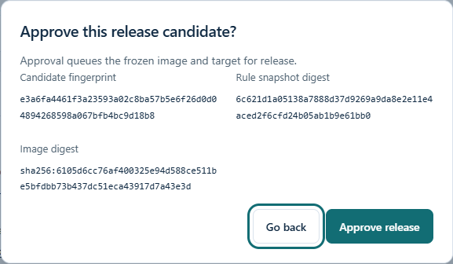

<h1 align="center">Itervane · 迭航</h1>

<p align="center">
  <strong>Open-source, self-hosted delivery and operations for apps built with AI.</strong><br>
  Audit and repair a pinned Git revision, verify the result in a disposable VM, and approve the exact image you deploy.
</p>

<p align="center">
  <a href="https://github.com/MaLaNg116/itervane/releases/tag/v0.1.0"></a>
  <a href="https://github.com/MaLaNg116/itervane/actions/workflows/verification.yml?query=branch%3Amain"></a>
  <a href="LICENSE"></a>
</p>

<p align="center">
  <a href="README.zh-CN.md">简体中文</a> ·
  <a href="#self-host">Self-host</a> ·
  <a href="#release-evidence">Release evidence</a> ·
  <a href="#development">Development</a>
</p>

<p align="center">
  <br>
  <em>Release approval in the v0.1 portal with synthetic data.</em>
</p>

## Workflows

- **Deliver a verified release.** Start an audit from the portal or an external MCP client. The Agent reviews scanner evidence and prepares a fix, and a separate job verifies the candidate. A maintainer approves the image before Itervane deploys it and checks the running version and protected health endpoint.
- **Operate a protected app.** Diagnose a health incident from container state, logs, metrics and release history. Approve a scoped restart or a restore to a specific release, then verify recovery. Route code defects to a linked repair task.
- **Learn from completed work.** Turn verified cases into code rules and Runbooks. Test positive and negative examples, review and publish a version, and use it in later tasks. Import reviewed design Skills as advisory guidance for audits.

## Self-host

The reference host is **Ubuntu 24.04 x86-64** with **Node.js 24**, **pnpm 11.9.0** and **Docker Compose**. The first step starts the bilingual portal, PostgreSQL and Keycloak on loopback. [Reference installation and upgrade](docs/reference-installation.md#english)

### Start the control plane

For a fresh installation, download `itervane-0.1.0.tar.gz`, `SHA256SUMS`, `release-manifest.json` and `dependency-licenses.json` into the same directory. Run these commands in a shell on the reference host. [v0.1.0 downloads](https://github.com/MaLaNg116/itervane/releases/tag/v0.1.0)

```sh
sha256sum --check SHA256SUMS
tar -xzf itervane-0.1.0.tar.gz
cd itervane-0.1.0
pnpm install --frozen-lockfile --ignore-scripts
pnpm build:portal

reference_dir="$HOME/.local/state/itervane/reference"
install -d -m 0700 "$(dirname "$reference_dir")"
pnpm reference:prepare "$reference_dir"
docker compose --project-directory "$reference_dir" --env-file "$reference_dir/.env" \
  -f "$reference_dir/compose.yml" up --detach --wait
pnpm reference:init "$reference_dir"
```

From the extracted source directory, start the API and Worker in separate terminals.

```sh
pnpm reference:start "$HOME/.local/state/itervane/reference" api
```

```sh
pnpm reference:start "$HOME/.local/state/itervane/reference" worker
```

Open the portal URL printed by `reference:init`. Sign in with the initial owner credentials from the private `owner-login.env` file and change the initial password. Register a public HTTPS repository, submit a fixed commit, and read the task in the portal or through the scoped MCP client. [Install walkthrough](docs/reference-installation.md#english)

### Enable execution and operations

Project execution waits for a qualified KVM Runner. Configure a model and the sealed Runner inputs for audit and verification. To enable release and operations, register the Komodo target, protected ingress and Whiskers scope. [Runner setup](docs/reference-runner-installation.md#english) · [Model configuration](docs/release-components.md#模型与规则--models-and-rules) · [Protected releases](docs/reference-release-installation.md#english) · [Restart](docs/control-plane-restart.md) · [Version restore](docs/control-plane-restore.md)

## Runtime model

The portal and external MCP share a TypeScript control plane. PostgreSQL holds tasks, approvals, the durable queue and Agent checkpoints. Five bounded ReAct roles cover audit, repair, verification, operations and rule extraction. Internal MCP connects Agents to scoped operational tools. [Blueprint v6](docs/blueprint-v6.md) · [Implementation plan](docs/implementation-plan-v2-ts-postgresql.md)

The v0.1 scope is one maintainer, one workspace and one active business workflow. It supports registered public HTTPS Git repositories at a fixed commit and the standard React/Vite + Node.js/Express template, packaged as one image with synthetic or public data. Project workloads run in disposable VMs. Human approvals bind the exact artifact or operation, and an independent check verifies the downstream result. [MVP scope](docs/blueprint-v6.md#17-最小-mvp-的边界)

## Release evidence

The published v0.1.0 receipt records three independent delivery runs, three independent operations runs, code rule and Runbook reuse, and 339 passing PostgreSQL 17.12 integration tests. It also records a clean archive reinstall, a database upgrade and a cold restore that includes a verified OCI archive. [Release receipt](https://github.com/MaLaNg116/itervane/releases/download/v0.1.0/release-acceptance.json) · [Acceptance criteria](docs/release-acceptance.md#english)

Hosted workflows use scripted Anthropic protocol responses against real reference infrastructure. Live model probes cover audit, template repair and operations diagnosis, with human intervention recorded in some multi-step cases. [Release evaluation](docs/release-evaluation.md#english)

## Development

In a checkout, install the locked dependencies and run the fast checks.

```sh
pnpm install --frozen-lockfile --ignore-scripts
pnpm check
```

Run `pnpm test:integration` with Docker or a dedicated PostgreSQL 17 test database. Use `pnpm test:portal` for browser coverage with Keycloak and Chromium or Chrome. [Verification workflow](.github/workflows/verification.yml)

For a change, start with the project conventions and the relevant stage guide. [Development conventions](AGENTS.md) · [Design baseline](docs/baseline.md) · [Review Guide index](docs/reviews/README.md)

## License

Itervane is licensed under Apache-2.0. Third-party components, model services and rule packages carry their own licenses or terms. [LICENSE](LICENSE) · [Component notices](docs/release-components.md)
