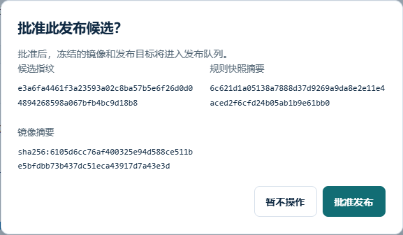

<h1 align="center">Itervane · 迭航</h1>

<p align="center">
  <strong>面向 AI 辅助开发的开源、自托管应用交付与运维平台。</strong><br>
  审计和修复固定的 Git 版本，在一次性虚拟机中复验，并由维护者批准即将部署的确切镜像。
</p>

<p align="center">
  <a href="https://github.com/MaLaNg116/itervane/releases/tag/v0.1.0"></a>
  <a href="https://github.com/MaLaNg116/itervane/actions/workflows/verification.yml?query=branch%3Amain"></a>
  <a href="LICENSE"></a>
</p>

<p align="center">
  <a href="README.md">English</a> ·
  <a href="#自托管">自托管</a> ·
  <a href="#发布验收">发布验收</a> ·
  <a href="#开发">开发</a>
</p>

<p align="center">
  <br>
  <em>使用合成数据展示 v0.1 门户的发布审批。</em>
</p>

## 三条工作流

- **开发交付。** 从门户或外部 MCP 客户端发起审计。Agent 阅读扫描证据并准备修复，独立复验任务检查候选。维护者批准镜像后，Itervane 部署镜像并核对实际运行版本和受保护的健康端点。
- **受控运维。** 结合容器状态、日志、指标和发布历史诊断健康事件。批准有明确范围的重启或指定版本恢复，再核对恢复结果。代码问题可进入关联修复任务。
- **经验复用。** 从已核验案例提炼代码规则和 Runbook，验证正反样例，经审核发布版本供后续任务使用。经过审核的设计 Skill 可作为审计参考。

## 自托管

参考环境为安装了 **Node.js 24**、**pnpm 11.9.0** 和 **Docker Compose** 的 **Ubuntu 24.04 x86-64** 主机。第一步会在本机回环启动双语门户、PostgreSQL 和 Keycloak。 [参考安装与升级](docs/reference-installation.md)

### 启动控制面

首次安装时，将 `itervane-0.1.0.tar.gz`、`SHA256SUMS`、`release-manifest.json` 和 `dependency-licenses.json` 下载到同一目录，在参考主机的 Shell 中执行。 [v0.1.0 下载](https://github.com/MaLaNg116/itervane/releases/tag/v0.1.0)

```sh
sha256sum --check SHA256SUMS
tar -xzf itervane-0.1.0.tar.gz
cd itervane-0.1.0
pnpm install --frozen-lockfile --ignore-scripts
pnpm build:portal

reference_dir="$HOME/.local/state/itervane/reference"
install -d -m 0700 "$(dirname "$reference_dir")"
pnpm reference:prepare "$reference_dir"
docker compose --project-directory "$reference_dir" --env-file "$reference_dir/.env" \
  -f "$reference_dir/compose.yml" up --detach --wait
pnpm reference:init "$reference_dir"
```

在解包后的源码目录中，用两个终端分别启动 API 和 Worker。

```sh
pnpm reference:start "$HOME/.local/state/itervane/reference" api
```

```sh
pnpm reference:start "$HOME/.local/state/itervane/reference" worker
```

打开 `reference:init` 输出的门户地址。使用私有 `owner-login.env` 里的初始维护者身份登录并修改初始口令。登记公开 HTTPS 仓库，提交固定 commit，然后在门户或有相应作用域的 MCP 客户端读回任务。 [安装步骤](docs/reference-installation.md#启动与验证)

### 启用项目执行和运维

项目执行需要通过验证的 KVM Runner。配置模型与封存的 Runner 输入后可执行审计与复验。启用发布和运维时，按参考配置登记 Komodo 目标、受保护入口与 Whiskers 作用域。 [Runner 安装](docs/reference-runner-installation.md) · [模型配置](docs/release-components.md#模型与规则--models-and-rules) · [受保护发布](docs/reference-release-installation.md) · [获批重启](docs/control-plane-restart.md) · [指定版本恢复](docs/control-plane-restore.md)

## 运行机制

门户和外部 MCP 共用 TypeScript 控制面。PostgreSQL 保存任务、审批、持久化队列与 Agent 检查点。五种受限 ReAct 角色覆盖审计、修复、复验、运维和规则提炼，内部 MCP 连接有明确作用域的运维工具。 [v6 蓝图](docs/blueprint-v6.md) · [实施计划](docs/implementation-plan-v2-ts-postgresql.md)

v0.1 面向单维护者、单工作区，同一时间运行一个业务工作流。支持登记的公开 HTTPS Git 仓库与固定 commit，以及使用合成或公开数据的 React/Vite + Node.js/Express 标准模板，交付为单镜像。项目负载在一次性虚拟机内运行。人工审批绑定指定产物或操作，执行结果由独立读回核验。 [MVP 范围](docs/blueprint-v6.md#17-最小-mvp-的边界)

## 发布验收

v0.1.0 发布回执记录了三次独立开发交付、三次独立运维、代码规则与 Runbook 的后续复用，以及 339 项 PostgreSQL 17.12 集成测试。源码包干净重装、数据库升级和包含已核验 OCI 归档的冷备恢复也已通过。 [发布回执](https://github.com/MaLaNg116/itervane/releases/download/v0.1.0/release-acceptance.json) · [验收判据](docs/release-acceptance.md)

托管闭环使用固定 Anthropic 协议响应，参考基础设施为真实服务。真实模型探测包含审计、模板修复和运维诊断，部分多步样例进入人工介入。 [发布评测](docs/release-evaluation.md)

## 开发

在源码 checkout 中安装冻结依赖并运行基础检查。

```sh
pnpm install --frozen-lockfile --ignore-scripts
pnpm check
```

使用 Docker 或专用 PostgreSQL 17 测试库运行 `pnpm test:integration`。浏览器用例通过 `pnpm test:portal` 启动，使用 Keycloak 与 Chromium 或 Chrome。 [验证流程](.github/workflows/verification.yml)

修改前可查看项目约定与相应阶段的导读。 [开发约定](AGENTS.md) · [设计基线](docs/baseline.md) · [Review Guide 索引](docs/reviews/README.md)

## 许可证

Itervane 自有代码采用 Apache-2.0。第三方组件、模型服务和规则包适用各自的许可证或条款。 [LICENSE](LICENSE) · [组件与许可证](docs/release-components.md)
