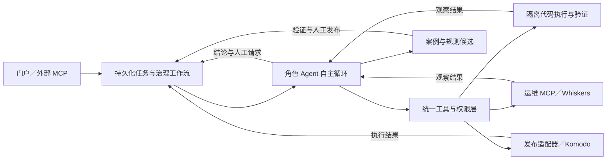

# Itervane 蓝图 v6

- 文档版本：v6，已确认的产品与架构基线。
- 整理日期：2026-11-16。
- 项目定位：个人长期建设、通用开源、可自托管。
- 实现状态：P0 验证与独立 P1-A/P1-B 模块已有局部实现，完整阶段尚未验收；本文描述目标与约束，实际交付见 review 索引。
- 配套文档：[开发基线与一致性约束](baseline.md)、[实施计划 v2：TypeScript + PostgreSQL](implementation-plan-v2-ts-postgresql.md)。

本文保留已确认 v6 的完整 19 节设计，仅整理标题与排版，并将 LangGraph 工作流、恢复参考链接统一到 TypeScript 文档。主技术栈、数据库与并发落地方式以配套实施计划 v2 为准；它们不改变本文的完整愿景、三条闭环、Agent 架构和安全边界。

文中的第三方版本与功能描述是前期调研基线，不代表已完成集成验证；实际依赖、协议与镜像组合在 P0 实测后锁定。

**状态：最终蓝图与后续实施基线。** 技术接口、运行参数和具体实现通过实施与评测继续修订。

---

## 1. 项目定位

一个个人长期建设、通用开源、可自托管的 Agent 应用交付与运维平台。

平台继承最初的产品愿景：

> 业务方通过 AI 完成大部分应用开发、审计、修复、发布和日常运维；工程师维护平台、规则与授权，处理无法可靠自动化的例外；有效经验经过验证，逐步成为可复用能力。

内置 Agent 的审计、修复、复验、运维和规则提炼是核心。MCP 同时承担外部编码助手接入，以及平台连接受控工具的职责。

“个人长期项目”描述建设和维护方式。长期产品支持多个业务中心，以组织、工作区、项目、应用和环境表达通用边界，不绑定特定企业。

## 2. 真正解决的问题与项目价值

AI 能够快速生成可运行代码，但应用投入实际使用仍需要解决：

- 用途、负责人、数据和访问范围是否明确。
- 是否符合安全、设计及组织规范，问题是否真正修复。
- 审批版本、构建产物和实际运行版本是否一致。
- 上线异常如何诊断、处置、验证和恢复。
- 重复问题如何形成规则与运维经验。

平台将这些事项组织成有证据、有权限边界、可持续执行的闭环，减少逐项目人工处理。

作为个人工程项目，还要系统实践：

- Agent 自主工具调用、计划调整和失败处理。
- 长任务持久化、人工介入、取消与恢复。
- 角色协作、上下文管理和分层记忆。
- 隔离执行、权限控制和副作用管理。
- Agent 行为评测、回归测试和经验沉淀。

已有 AI 应用平台、DevSecOps 与部署工具提供大量相似能力。本项目的差异定位是：**与编码工具解耦、整体可自托管、开发与运维贯通，以及经过验证的规则积累。** 组合价值通过真实项目和评测证明，不以市场空白为前提。

## 3. 完整愿景包含三条相互连接的闭环

| 闭环 | 完整流程 |
|---|---|
| **开发交付** | 接入项目 → 理解与审计 → 修复 → 复验 → 冻结候选 → 审批 → 发布 → 上线验证 |
| **运行维护** | 发现异常 → 收集证据 → 诊断 → 提出处置 → 授权执行 → 验证恢复 → 必要时进入代码修复 |
| **能力积累** | 记录案例 → 判断泛化价值 → 生成规则或 Runbook → 样例验证 → 人工审核 → 后续任务复用 |

用户可以继续使用自己的编码助手和代码仓库，也可以交由平台内置 Agent 处理交付与维护问题。

长期支持标准模板创建、项目上传、后续版本变更、周期性漏洞复查和应用下线。

## 4. Agent 架构采用外层治理工作流与内层自主循环

外层工作流负责阶段、权限、预算、审批、状态和恢复；内层 Agent 根据目标与观察结果，自主选择调查和处理路径。

核心任务 Agent 采用 ReAct 式循环：

`读取目标与当前证据 → 更新计划或假设 → 选择工具 → 权限检查 → 执行 → 观察结果 → 继续、调整、结束或请求人工`

审计、修复和运维角色不能仅实现为预设提示词的顺序调用。计划和反思按需要发生，不要求每次工具调用都额外增加一轮模型调用。

ReAct 强调判断与环境行动交替推进；工作流与动态 Agent 可以组合使用。[ReAct 原始论文](https://arxiv.org/abs/2210.03629)、[工作流与 Agent 的区分](https://docs.langchain.com/oss/javascript/langgraph/workflows-agents)

## 5. Agent 执行框架是自研核心之一

复用编排框架、模型 SDK 和工具基础，在其上实现面向本项目的 Agent 执行框架，即 Agent Harness。

| 能力 | 必须承担的责任 |
|---|---|
| 任务契约 | 明确目标、输入版本、允许范围、完成条件和停止条件 |
| 执行循环 | 支持动态工具选择、观察反馈和计划调整 |
| 工具管理 | 根据角色与阶段提供工具，校验参数、目标和权限 |
| 上下文管理 | 按需检索、控制长度、压缩历史、保留证据引用 |
| 预算管理 | 限制模型消耗、工具调用、执行时间和重复尝试 |
| 进展判断 | 识别无进展、重复动作、失败假设和转人工条件 |
| 输出契约 | 交付结构化结果、产物、证据及未完成事项 |
| 恢复管理 | 保存进度，恢复前重新检查有效状态与授权 |

参考编排底座首选 **LangGraph 开源库**。它承担工作流和检查点基础；领域执行循环、验证要求和治理语义由本项目明确实现。

MVP 使用一个运行时调度多个逻辑角色，先串行执行。后续根据收益增加并行任务、专门子 Agent 和多模型验证。Agent 数量不作为完成度指标。

## 6. 内置五种逻辑角色

| 角色 | 核心职责 | 必须交付的结果 |
|---|---|---|
| **审计 Agent** | 理解项目、调用扫描器、追踪相关代码、验证怀疑 | 发现清单、证据、置信度、覆盖限制 |
| **修复 Agent** | 制定方案、应用模板或生成代码、处理反馈 | 代码差异、修改说明、修复快照 |
| **复验 Agent** | 独立检查修改、执行受保护检查、识别回归 | 已解决、未解决、新增问题与未验证事项 |
| **运维 Agent** | 观察应用、诊断异常、执行获批处置、验证恢复 | 诊断证据、操作计划、实际结果 |
| **规则提炼 Agent** | 分析案例、判断泛化价值、生成规则和处置流程 | 有来源、范围、样例与验证结果的候选包 |

角色使用不同上下文、工具权限和输出要求，可以复用同一模型。任务按需要进入角色，无须每次都调用全部角色。

同一模型分别承担修复和复验，不构成独立安全保证。正式通过条件仍依靠受保护检查、实际证据和必要的人类判断。

## 7. 上下文、状态与记忆分别管理

| 类型 | 保存内容 | 权威性 |
|---|---|---|
| 当前任务上下文 | 目标、计划、近期工具结果和待处理事项 | 支持当前执行 |
| 正式任务与产物记录 | 源码版本、差异、报告、授权和执行结果 | 正式事实依据 |
| 历史案例与经验 | 成功、失败、人工反馈和适用条件 | 可检索参考 |
| 已发布规则与 Runbook | 经验证和审核的检查及处置定义 | 按版本和策略生效 |

执行原则：

- 按问题检索相关代码与材料，避免默认塞入整个仓库。
- 摘要保留来源与版本，压缩历史不能丢失关键证据。
- 项目文档、日志和工具返回标明来源，不能覆盖平台指令和权限。
- 角色交接传递结构化发现、产物引用和待验证问题。
- 事实以正式记录和实际观测为准，模型总结不能直接改写事实。
- 经验沉淀属于案例、指导和规则更新；MVP 不涉及在线训练模型权重。

## 8. 审计、修复和复验形成可验证循环

审计结合确定性扫描、Agent 上下文分析与针对性验证，区分：

- 已确认问题。
- 疑似问题。
- 未覆盖或无法验证的事项。

修复清单同时服务技术与业务人员，包含业务影响、触发条件、证据、修复方式、复验要求和升级原因。工作量估算必须注明依据，使用合理范围。

修复优先采用有明确前提的结构化方法，非模板问题允许受限代码修改。每次修改保留差异和快照。

复验在干净环境中运行，至少覆盖重新扫描、平台基线、针对性检查及新增问题比较。修复 Agent 无权修改发布标准、关闭强制扫描或自行写入“通过”。

平台基线与评分材料独立保存。新增测试可以补充验证；删除、跳过或削弱原有检查需要人工审查。

无法可靠处理、连续无进展或预算耗尽时，任务转为明确的人工处理状态，并保留已完成工作。

## 9. MCP 同时覆盖外部接入与内部工具连接

| 方向 | 首期职责 |
|---|---|
| **平台作为 MCP Server** | 向外部编码助手提供规则、预审、正式任务、结果查询、发布申请和运维能力 |
| **平台作为 MCP Client** | 连接已登记的运维等工具服务，获得观察与受控执行能力 |

外部 MCP 首期包括：

- 获取适用 Skill、规范和模板要求。
- 对有限代码片段或差异进行生成阶段预审。
- 对登记仓库的固定版本启动正式审计与修复。
- 查询发现、差异、复验结果和人工待办。
- 申请发布、发起运维诊断和申请处置。

预审标明输入来源和覆盖范围。正式发布仍以平台获取并验证的源码、产物和证据为依据。

门户与 MCP 共用权限、策略和审计。长任务返回任务标识，连接中断不丢失任务；客户端可以查询、取消或继续处理。

远程 MCP 采用所选协议版本的认证授权机制。每次工具调用在服务端校验用户、项目、资源和动作，下游凭证单独管理。工具描述、可见性和客户端确认不能代替正式授权。[MCP 安全实践](https://modelcontextprotocol.io/specification/2025-11-25/basic/security_best_practices)

内部工具可使用 CLI、SDK 或 MCP；基础设施操作统一经过受控工具层。

## 10. 工具必须具有明确契约

每个工具说明：

- 输入输出结构、作用范围和必要权限。
- 是否产生副作用，允许的目标和参数。
- 超时、取消与重试方式。
- 结果判据、错误类型和审计要求。
- 必要时的操作标识、去重与结果查询方式。

工具返回区分成功、业务失败、基础设施失败、等待批准和结果不确定。

非法参数或越权请求在执行前拒绝。重试策略由错误类型决定，不能把所有失败都交给模型重复尝试。

发布、重启和恢复等操作结果不确定时，先查询实际状态，再决定下一步。

## 11. 部署与运维采用 Komodo＋Whiskers 参考组合

| 责任 | 主要执行方 |
|---|---|
| 镜像版本、部署配置、发布和版本恢复 | Komodo |
| 应用状态、日志、指标及受控重启等运维能力 | Whiskers 等运维 MCP 后端 |
| 用户身份、项目范围、操作授权、并发协调和证据关联 | 平台治理核心 |

Komodo 作为首个部署后端，Whiskers 作为首个运维 MCP 集成目标。适配器可替换，Agent 运维和 MCP 能力必须保留。

Whiskers 1.0 的权限等级作用于全部受管服务器，且具有较强主机控制能力，因此 MVP 限定单一运维信任域，凭证保留在服务端，外部助手只连接平台 MCP。[Whiskers 权限边界](https://github.com/LupusMalusDeviant/Whiskers/blob/v1.0.1/docs/v1/PRODUCT_CONTRACT.md)

所有普通入口沿用同一治理规则。平台业务授权与下游原生权限、确认闸门关联到同一操作记录，未满足条件时保持暂停。

发布、重启和版本恢复按应用协调，执行前核对目标与实际版本。管理控制台的应急操作单独留痕。

## 12. 运维 Agent 具备真实但有限的执行能力

运维任务由门户、外部 MCP 或登记的监控事件触发。

| 操作 | MVP 行为 |
|---|---|
| 状态、脱敏日志、指标查询与诊断 | 在授权项目范围内自动执行 |
| 重启指定应用 | 人工确认后执行并验证恢复 |
| 恢复指定已发布版本 | 经授权通过部署后端执行 |
| 怀疑代码缺陷 | 创建关联修复任务，进入交付闭环 |
| 删除数据卷、任意宿主机命令、主机权限修改 | 不向首期普通 Agent 开放 |

诊断区分观测事实、原因假设和建议动作。监控触发具有去重、冷却、执行次数与停止条件。

一次重启未恢复时，转人工或进入修复，避免持续重启掩盖故障。

线上代码和配置变更通过新候选完成。运维处置、代码修复及后续发布保留关联。

## 13. 规则、Skill 和 Runbook 经过验证后积累

规则包可以包含 `SKILL.md`、参考资料、设计资源、声明式检查、修复模板与验证样例，并记录来源、许可证、版本、适用范围和审核状态。

| 内容 | 用法 |
|---|---|
| Skill 与文字指导 | 帮助 Agent 理解规范和方法 |
| 检查规则 | 产生明确警告或发布阻断 |
| 历史案例 | 支持检索、分析和评测 |
| Runbook | 描述运维症状、前提、动作、审批和恢复验证 |

沉淀流程：

`选择案例 → 判断泛化价值 → 查找已有能力 → 生成候选 → 正反样例验证 → 人工审核 → 发布版本 → 后续任务验证`

代码规则包含违规、已修复及易误判样例。Runbook 包含目标范围、执行前提、允许动作、次数限制、成功判据和停止条件。

单次成功可以产生候选，但不能直接证明规则适用于所有项目。不适合泛化的内容保留为案例。

MVP 支持维护者导入、发布和回滚声明式规则包，包含设计规范示例。任意脚本插件不进入首期。

规则和 Runbook 的发布不自动授予线上操作权限。扫描器与规则分别检查许可证，不默认打包不可再分发的规则。[Semgrep 许可证说明](https://docs.semgrep.dev/licensing)

## 14. 授权绑定具体交付物与操作

发布候选关联：

- 原始版本、修复快照和代码差异。
- 模板、规则、扫描器及验证工具版本。
- 报告、覆盖范围和未完成事项。
- 镜像 digest、运行配置与目标环境。
- 审批、有效期、上线验证及恢复方案。

运维授权关联具体应用、实际版本、动作、参数、前提、有效期和执行次数。

关键内容或目标变化后产生新候选或重新授权。规则变化、检查过期和权限撤销需要重新判断。

| 模式 | 审批安排 |
|---|---|
| **个人模式，MVP 默认** | 同一维护者可以提交并人工确认，明确记录为本人确认 |
| **团队模式，长期能力** | 支持独立审核人、项目权限和风险分级审批 |

Agent 没有人类审批权。

长期支持低风险自动通过、中风险修复复验后按策略确认、高风险授权人员处理。无法验证、超出支持范围和违反安全底线分别记录。

MVP 的发布及有影响的运维动作均需人工确认，不提供通用的安全底线豁免按钮。

## 15. 安全、隔离与恢复边界

- 不可信代码在专用、可销毁或可靠重置的环境运行，参考边界为独立虚拟机。
- 治理服务、修复环境、运行环境与基础设施凭证分离。
- 文件和命令工具限定在当前任务环境。
- 凭证发现脱敏处理；真实泄露由持有者撤销或轮换。
- 模型推理支持本地或获准的外部服务，明确源码与证据出域范围。
- 对时间、消耗、网络和计算资源设限，并支持取消。
- 应用访问和平台登录分别授权，运行入口不能绕过访问保护。
- 正式规则、授权、基线和审计记录不由修复工作区控制。
- 治理不可用时停止新增高权限动作，已有应用不能自动变为匿名开放。
- 宿主机管理员属于明确的受信任边界，应急操作单独记录。

任务恢复前重新核对身份、版本、预算和有效授权。框架检查点不能单独保证副作用只执行一次，外部操作需要去重和真实状态核对。[LangGraph 中断与恢复说明](https://docs.langchain.com/oss/javascript/langgraph/interrupts)

MVP 不处理生产数据库迁移。长期引入有状态服务和不可逆操作时，单独定义备份、补偿与恢复要求。

## 16. 复用与自研边界

| 能力 | 复用基础 | 自研重点 |
|---|---|---|
| 模型接入、基础工具调用 | 成熟 SDK 与协议适配 | 角色、上下文、预算及错误处理 |
| 编排、持久化检查点 | LangGraph 开源库 | 领域工作流与恢复语义 |
| 文件搜索和补丁操作 | 成熟工具与库 | 工作区边界与变更记录 |
| 密钥检查 | Gitleaks CLI | 脱敏、归一化及处置状态 |
| 依赖、镜像和配置检查 | Trivy | 与候选及发布条件关联 |
| 代码模式检查 | Semgrep CE 等检查器 | 可分发规则与生成规则验证 |
| Git、OCI 镜像存储 | 现有服务 | 快照、补丁和产物证据关联 |
| 部署与运维 | Komodo、Whiskers 优先 | 受控适配与操作协调 |
| 登录、访问代理、基础监控 | 现有组件 | 项目、应用与任务身份关联 |
| MCP 协议 | 官方或成熟 SDK | 领域工具、权限和异步任务契约 |
| Agent Harness | **核心自研** | 自主循环、上下文、停止与交接 |
| 规则与 Runbook 管理 | **核心自研** | 来源、样例、审核、版本和复用 |
| 门户、治理 API、记录与评测 | **核心自研** | 可理解的状态、证据与回归标准 |

Backstage、DefectDojo 等保留后续集成可能，不成为 MVP 必选依赖。首期不重建 IDE、Git、容器平台或身份系统。

## 17. 最小 MVP 的边界

| 维度 | MVP 范围 |
|---|---|
| 使用方式 | 单维护者、个人模式、单工作区，任务串行执行 |
| 输入 | 登记 Git 仓库的固定版本；片段与差异预审单独标记 |
| 应用类型 | 标准 React/Vite＋Node.js/Express 模板，单仓库、单镜像 |
| 数据 | 模拟或确认可公开的数据，无生产系统写入 |
| 业务状态 | 无持久化业务数据库及数据库迁移 |
| Agent | 五种逻辑角色，核心任务具备动态工具与观察反馈循环 |
| 模型 | 一种可用模型接入 |
| 外部 MCP | 规则、预审、任务发起查询、发布申请和运维入口 |
| 内部 MCP | 一个真实运维后端，优先 Whiskers，含观察与获批执行 |
| 修复 | 模板修复与受限代码修改，保存快照和可导出补丁 |
| 复验 | 扫描、基线、针对性验证及新增问题比较 |
| 发布 | 一个 Komodo 适配器，固定目标，人工确认 |
| 运维 | 日志、指标、基础健康异常触发、重启和指定版本恢复 |
| 访问 | 默认受保护，不开放匿名公网应用 |
| 沉淀 | 至少一条代码规则及一条 Runbook 完成审核和后续复用 |
| 任务控制 | 持久化、预算、取消、人工暂停恢复 |
| 运维基础 | 单治理实例、持久化记录和备份恢复，不承诺高可用 |

MVP 不包含任意技术栈、开放 SaaS 多租户、通用 IDE、任意脚本插件、通用主机运维、无人审批发布或自动发布强制规则。

## 18. 完成标准与评测

MVP 必须证明三条路径：

- **开发交付：** 外部助手通过 MCP 接入，内置 Agent 发现并修复真实缺陷，复验通过后经人确认发布，实际运行版本正确。
- **运维恢复：** 异常触发诊断，Agent 根据证据选择动作，调用真实运维后端执行获批处置，验证恢复或正确升级处理。
- **经验复用：** Agent 生成规则或 Runbook 候选，经样例验证和人审发布，后续任务产生预期结果。

Agent 工程还须证明：

- 同一任务面对不同工具结果，会选择不同调查或处理路径。
- 失败后能够调整方案，识别无进展并停止。
- 修复引入回归时不能通过。
- 恶意材料不能取得新权限或改变正式标准。
- 断连和重启后能恢复，旧授权和副作用不会被盲目重复。
- 模型、工具、预算或环境异常有明确状态和处理方式。

从人工标注的小型评测集开始，包含缺陷、正常代码、回归陷阱、误导性指令、运维异常及无法自动处理的任务。保留独立验证样例，避免仅对生成样例优化。

对简单任务保留确定性流程作为对照，比较 Agent 在复杂例外中的收益。回放与评测默认使用隔离环境或记录的工具结果，不重放线上副作用。

持续观察检出与误报、修复与回归、恢复时间、重复操作、人工介入、耗时、模型成本和规则复用效果。“Agent 声称完成”不作为成功依据。

## 19. 开源原则与后续演进

核心代码建议采用 **Apache-2.0**，依赖、模型组件和规则包分别保留许可证。必要的权限、审计、审批、恢复和评测能力包含在开源核心中。

平台不依赖付费控制面或强制云端追踪服务。选择外部模型时明确数据边界；离线运行需要本地模型及相应依赖。

后续逐步扩展多工作区、多节点、团队权限、分级自动化、更多技术栈、项目上传、PR 工作流、更多 MCP 后端和持续维护能力。

框架、接口和参数可以在实施中调整，变更应关联决策记录与回归证据。核心闭环、授权边界和完成标准保持清楚。

**最终交付定义：一个可自托管的平台，让业务人员通过外部编码助手或内置自主 Agent，完成有证据的应用审计、代码修复、复验、发布和受控运维；让有效经验经过验证，成为后续任务可复用的规则与 Runbook，同时形成一套完整、可评测、可恢复的 Agent 工程实现。**

