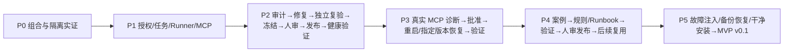

# Itervane 开发计划 v1

- 日期：2026-11-16。
- 依据：[蓝图 v6](blueprint-v6.md)、[TS + PostgreSQL 实施计划 v2](implementation-plan-v2-ts-postgresql.md)。
- 当前：P0 验证底座进行中，关键闸门未通过，P1 尚未开工。

本计划将既定路线拆成开发任务。最终交付仍是完整的开发交付、受控运维、规则与 Runbook 复用三条闭环；当前代码是选型和机制的验证程序，不是缩减后的平台 MVP。

## 1. 开发约束

- 单维护者、单工作区、全局一个执行中的业务工作流；人工暂停后释放槽位。
- 五种 Agent 逻辑角色、外层确定性治理、内层自主工具循环、双向 MCP 都保留。
- 发布与有影响运维操作需人工确认，绑定真实目标、版本及参数；Agent 没有批准权。
- 不可信源码、安装、测试和构建进入一次性虚拟机；不因硬件条件不足改用普通容器隔离。
- 真实领域记录、正式检查和下游状态决定结果；模型声明、队列状态及检查点不承担批准或验收权。
- 按需求点提交，提交信息使用中文 Conventional Commits；每个提交给出对应阶段、验证和限制。

## 2. P0：用真实组合验证关键机制

| 任务 | 实作与产物 | 依赖 | 出口条件 |
|---|---|---|---|
| 0.1 工作区和契约初版 | pnpm、Node 24、TS strict、共享 Zod 契约、任务转换与工具状态 | 无 | 固定源码输入；拒绝客户端自带批准/权限；角色、状态和错误语义有检查 |
| 0.2a 模型适配与循环探针 | Anthropic/OpenAI SDK 适配、结构化工具输入、观察反馈、预算、取消和停止 | 0.1 | 协议夹具通过；真实模型在健康/故障两类观察下选择不同有效路径；凭证不进结果 |
| 0.2b MCP 与图恢复 | 官方 SDK HTTP Client/Server、认证/Origin 检查、LangGraph PostgreSQL interrupt/resume | 0.1、0.3 | 真实客户端重连；新 checkpointer 连接恢复；恢复不授予批准权 |
| 0.3 数据库与调度原型 | PG17、Drizzle 事务入队、幂等、竞争、租约/代次、重试、取消、Worker 崩溃恢复 | 0.1 | 真实 PG 验证；回滚无孤儿唤醒；重复请求一个任务；旧执行者不能写入；重试有上限 |
| 0.4a 环境预检 | SSH 严格校验主机身份，只读检查 KVM/CPU/libvirt | 无，可并行 | 确认候选宿主是否满足 VM 前置条件；不自动安装或退化隔离 |
| 0.4b 虚拟机验证 | 创建、执行、CPU/内存/磁盘/超时限制、网络限制、重置、销毁 | 0.4a 通过 | 跨任务残留、越界文件和受限出口测试；失败后无遗留资源；保留 Runner 契约 |
| 0.5 原生部署与运维 | 隔离测试目标中验证 Komodo 版本/发布/恢复与 Whiskers MCP 观察/确认/重试 | 0.2b、0.4b | 未批准不能变更；原生 Confirm → 批准 → 绑定同一请求重试；核对实际结果和下游 ID |
| 0.6 评测材料 | 标准 React/Vite+Express 无状态单镜像样例；24 个案例含保留集及确定性对照 | 0.1，可并行准备 | 基线可构建测试；案例输入可复现；预期与实际结果分离；正式执行按阶段接入 |
| 0.7 兼容基线与准入 | 精确依赖、镜像 digest、协议、许可元数据、证据、限制与 ADR | 前述全部 | 关键能力真实通过，未通过项不隐去；P0 完整验收后才正式进入 P1 |

P0.3 的表与队列位于随机测试 schema，能够证明选定库的机制，不能直接充当 P1 的正式数据库迁移或授权服务。P0.2 的模型循环只调用模拟只读工具；五种领域 Agent 在后续阶段实现。

真实 Anthropic 协议模型的两条观察路径已通过。当前未通过：支持 KVM 的 Runner 环境及 VM 生命周期、Komodo/Whiskers 原生链路、标准镜像及受保护部署验证。其余可独立工作先完成。详细运行结果以 [P0 记录](p0-verification.md) 和忽略提交的本地报告为准。

## 3. P1：把验证结论落实为正式安全任务底座

P0 全部关键闸门通过后开始；这里明确后续任务，不提前宣称已经实现。

| 任务 | 开发内容 | 依赖 | 验收依据 |
|---|---|---|---|
| 1.1 身份与资源登记（M01） | OIDC、单维护者初始化、工作区/项目/应用/环境、登记仓库与下游资源映射 | P0 | 只有经过认证的当前主体可访问登记项目；MCP/门户同一授权 |
| 1.2 正式领域模型（M02/M07/M13） | Drizzle 迁移、版本化状态更新、任务/run、候选、批准、操作、证据引用与事件 | 1.1 | 无常驻 DDL；迁移可重建；唯一约束、预期版本和状态转换真实生效 |
| 1.3 调度和恢复（M02） | 原子入队、执行代次、租约/心跳、全局槽位、持久化暂停、取消、检查点核对 | 1.2 | API/Worker 重启不丢任务；两个执行者仅一个有效；旧结果拒收；暂停释放槽位；父子任务不死锁 |
| 1.4a 工具网关（M05） | 类型、参数、项目/目标/路径、有效 run、权限、预算、副作用、错误分类 | 1.1—1.3 | 无效参数或越权请求在下游前拒绝；检查点或 Skill 无法扩大权限 |
| 1.4b Runner 与扫描（M06/M07） | VM 控制器、固定 Git 快照、工作区工具、Gitleaks/Trivy/Semgrep、资源清理 | 1.4a、P0.4 | 真实扫描与哈希证据；执行在 VM；缺失/超时/不支持明确记录；取消清理 |
| 1.5 API/MCP/最小门户（M08/M12） | Fastify、公开契约、异步任务 ID、状态/证据/取消界面；规则查询与预审 | 1.1—1.4 | HTTP 与外部 MCP 共用领域服务；断连可查询；错误项目拒绝；状态一致 |

连接池统一预算，领域 schema、pg-boss schema、checkpointer schema 分别迁移和授权。模型、构建、人工等待和远端请求期间不持有数据库事务；工具前校验和正式写入使用当前代次，不采用先查后写的裸进程判断。

批准、唯一逻辑操作和唤醒同事务提交；远端执行不在此事务内。响应丢失先记结果未知并冻结冲突操作，使用下游 ID、版本和实际观察核对，不能自动重复副作用。

## 4. P2—P5：优先贯通完整 MVP

P2 实现 Harness 和审计、修复、复验角色：工具观察改变计划、失败返修或升级；修复角色不能改写受保护基线。冻结候选绑定源码、镜像、配置、规则及验证；改变内容必须重新判断批准。P2 验收完整开发交付路径。

P3 接入真正的 Whiskers MCP 观察和获批重启、Komodo 指定版本恢复：有限次数、冷却、目标和版本绑定、原生确认关联、结果核对；代码问题进入关联修复任务。P3 验收开发和运维两条闭环。

P4 实现规则提炼角色和 Skill/规则/Runbook 管理：候选、正反样例、隔离验证、人审发布、版本与回滚；至少一条代码规则和一条 Runbook 在后续真实任务被复用。设计规范可作为 Skill 及可验证声明式规则导入；任意上传脚本不在控制面执行。

P5 对三条闭环做重复真实运行、恶意输入和并发/故障验证、备份恢复、干净安装与许可清单。达到实施计划 v2 的全部出口，才交付 MVP v0.1。

不通过前置闸门时保留明确的未完成状态；不为了演示速度删除 Agent 运维、MCP、规则沉淀、人工确认或 VM 隔离。日历和后续任务细节根据 P0/P1 的实际验证调整。
