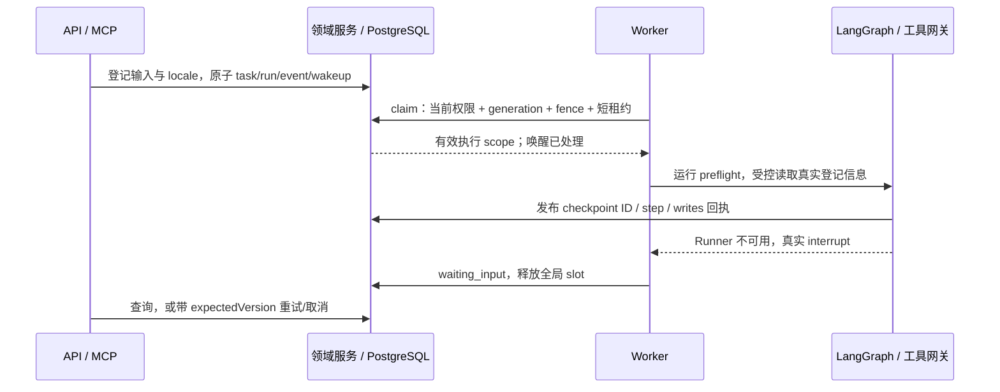

# P1-B Review guide：持久化调度、受控执行骨架、外部 MCP 与多语言

- 批次：003；PR 与依赖见 [交付索引](README.md)。
- 前置：P1-A / PR #2，比较基线 `f332826cc4d58394c38aa305ea09eeaed2e51e96`。
- 本批固定代码快照：`2ce5515600f0f7167170a26e522bcb77afe93c9e`。下文源码链接均固定在此版本，后续文档提交不改变讲解对应的代码。
- 日期：2026-11-18；[开发计划](../plans/p1-b-durable-execution-and-mcp.md)、[运行说明](../control-plane-p1-b.md)、[ADR 0002](../decisions/0002-checkpoint-publication.md)。

## 1. 先明确交付结果

P1-A 只接收和查询正式任务，P1-B 增加实际 Worker：消费唤醒、取得全局执行权、执行受信任数据库工具、保存 LangGraph 图中断、释放槽位、查询/取消/人工重试，并在进程中断后恢复。外部 MCP 现在连接正式领域服务和 PostgreSQL，接口、事件及工具说明支持英语/简体中文。

当前闭环终点是 `waiting_input / runner_unavailable`。它证明调度与治理骨架可恢复，不代表源码审计或完整 Agent 已完成。P2 仍要实现 v6 的 ReAct 式自主角色循环；真实 Runner、批准、发布和运维没有被放行。

三条闭环、五种逻辑角色、双向 MCP、单维护者/工作区/全局一个执行中工作流均保留。此批实现外部 MCP，平台连接 Whiskers 的运维 MCP 仍在后续阶段。

## 2. 建议阅读顺序

| 顺序 | 固定源码 | 重点 |
|---|---|---|
| 1 | [契约与 i18n](https://github.com/MaLaNg116/itervane/blob/2ce5515600f0f7167170a26e522bcb77afe93c9e/packages/contracts/src/i18n.ts) | 稳定机器码、语言协商、事件原因和完整资源键 |
| 2 | [schema.ts](https://github.com/MaLaNg116/itervane/blob/2ce5515600f0f7167170a26e522bcb77afe93c9e/packages/control-plane/src/persistence/schema.ts) | slot、runtime、预算、工具账本、checkpoint 回执 |
| 3 | [authority.ts](https://github.com/MaLaNg116/itervane/blob/2ce5515600f0f7167170a26e522bcb77afe93c9e/packages/control-plane/src/runtime/authority.ts) | 锁顺序、数据库时钟、领域事件、同事务唤醒 |
| 4 | [coordinator.ts](https://github.com/MaLaNg116/itervane/blob/2ce5515600f0f7167170a26e522bcb77afe93c9e/packages/control-plane/src/runtime/coordinator.ts) | claim、withLease、心跳、暂停、恢复扫描 |
| 5 | [tasks.ts](https://github.com/MaLaNg116/itervane/blob/2ce5515600f0f7167170a26e522bcb77afe93c9e/packages/control-plane/src/service/tasks.ts) | 语言兼容的入队幂等、取消、版本化 resume |
| 6 | [tools.ts](https://github.com/MaLaNg116/itervane/blob/2ce5515600f0f7167170a26e522bcb77afe93c9e/packages/control-plane/src/runtime/tools.ts) | 绑定目标、持久预算、预留和只读重放 |
| 7 | [checkpointer.ts](https://github.com/MaLaNg116/itervane/blob/2ce5515600f0f7167170a26e522bcb77afe93c9e/packages/control-plane/src/runtime/checkpointer.ts) | 不取 latest、发布回执、图 step、blob 分叉隔离 |
| 8 | [worker.ts](https://github.com/MaLaNg116/itervane/blob/2ce5515600f0f7167170a26e522bcb77afe93c9e/packages/control-plane/src/runtime/worker.ts) | 实际图执行、interrupt、恢复输入、停止与心跳 |
| 9 | [mcp.ts](https://github.com/MaLaNg116/itervane/blob/2ce5515600f0f7167170a26e522bcb77afe93c9e/packages/control-plane/src/mcp.ts) | 官方协议底座、固定 resource、scope 和领域复用 |
| 10 | [API](https://github.com/MaLaNg116/itervane/blob/2ce5515600f0f7167170a26e522bcb77afe93c9e/packages/control-plane/src/api.ts)、[Worker 入口](https://github.com/MaLaNg116/itervane/blob/2ce5515600f0f7167170a26e522bcb77afe93c9e/packages/control-plane/src/entries/worker.ts) | 两个独立进程、关闭顺序、公开能力及配置 |

SQL 与 Drizzle snapshot 是单独提交的数据库演进。四份 snapshot 为机械生成内容，占 diff 大部分；逐行检查新增 SQL 和 schema，再核对 snapshot 一致性即可。

## 3. 一次执行的关键路径

task/run/queue/checkpoint 各承担自己的职责：队列调度唤醒，领域状态定义业务事实，图保存可恢复进度，执行权和权限决定能否行动。没有让 queue completed 或 checkpoint interrupt 自动代表批准/成功。

## 4. 全局执行权与恢复

在 coordinator.ts 依次读 `claim`（第 52 行）、`withLease`（第 18 行）、`reconcile`（第 129 行）。

claim 在同一事务内完成旧唤醒并登记新执行权；队列任务完成与业务任务继续 running 并不矛盾。wakeup ID、当前 task/run generation、项目权限必须匹配，旧消息或已完成 attempt 不能再次取得权限。

withLease 先锁全局 slot，再锁 task，核对 worker/run/generation/fence/状态/租约，再查原提交者的当前项目权限。数据库操作完成后再次检查租约。暂停释放 slot 也不能跳过截止时间复核，心跳不能复活已过期租约。

`lockSlot` 特意分两次 SQL：先取得行锁，再读取数据库时钟；把 clock_timestamp 投影和 FOR UPDATE 放在一条 SELECT 中，可能在等锁前就求值。P0 对应回归测试也改用数据库主机时间等待，避免宿主与 Docker VM 调度差异。

reconcile 是正式领域恢复扫描，不依赖 pg-boss active job 自动等到过期：过期 running 重新入队，cancel_requested 确认取消，queued 丢失或终止的唤醒被补发。只有持有当前 fence 的执行者能继续。

`waitForChild` 检查同项目、自等和等待链循环，再释放 slot。此批只交付内部等待原语，未提供公开 spawn 或自动父子交接。

## 5. 取消与恢复的事务边界

在 tasks.ts 读 `cancel`（第 99 行）和 `resume`（第 120 行）。两个入口仍使用实际认证主体和当前项目权限，并与 Worker 采用一致的 slot → task 锁顺序。

- queued/等待态可以原子取消；running 先转 cancel_requested，立即阻断新工具/普通 checkpoint，再由 Worker 或过期恢复确认停止。
- resume 只接受 Runner waiting_input、已发布 checkpoint 和当前版本；不是人类部署批准。
- 两个请求拿同一个 expectedVersion，只有一个能够恢复；后续事件写失败时，resumeCount、状态和唤醒一起回滚。
- resume 最多 3 次，逻辑 run、locale 和 toolsUsed 都保留。不能通过反复恢复重置预算。

事件 actorKind 区分 `principal` 与 `worker`。JWT 只证明已认证主体，不能证明人在场；后续人类确认必须独立实现。迁移 0004 规范早期 human 标签，不更改主体 ID 和业务事件内容。

## 6. 只读工具网关

tools.ts 的 `call` 分为预留、受控读取、结果发布三个短事务边界；模型或远端工具等待不会放在这些事务中。

按 run/逻辑 key 的哈希去重，输入哈希防止同 key 换参数。首次预留才扣 toolsUsed；崩溃后 reserved 只读调用可重放，并发结果收敛到先提交的结果。每次入口/发布重新核验执行权及当前权限，失效 Worker 无法新增或覆盖观察。

`project.describe` 读取正式登记信息，并提供观察引用；它不是源码分析证据。`source.inspect` 返回明确 business_error，不能编造扫描结果。目录外工具、任意命令和更换目标的参数被拒绝，账本不保存原始参数。

默认预算 8 次，preflight 手动重试受独立上限约束。这里没有宣称已实现 P2 的角色策略、token/时间预算、无进展判断或副作用 operation ledger。

## 7. 为什么需要检查点发布协议

checkpointer.ts 的 `put/getTuple/putWrites` 是本批最值得详细 review 的部分，设计原因在 ADR 0002。

底层 saver 和领域事务使用不同连接，不构成一个跨库原子提交。包装器在短领域事务内锁定执行权，调用真实 saver，再发布领域指针/回执。若底层成功后进程终止或领域事务失败，底层可能有残留数据，所以恢复不能盲读 latest。

| 数据 | 恢复依据 | 故障防护 |
|---|---|---|
| checkpoint | runtime.checkpointId | 未发布的 latest 不参与恢复 |
| 发布顺序 | runtime.checkpointStep | 落后 step 不覆盖进度；不依赖 UUID 时间排序 |
| pending writes | 领域中提交的序列化值哈希回执 | 底层已写但领域回滚的中间结果被过滤，保持 saver 排序 |
| channel blobs | 沿用 PostgresSaver.getNextVersion | 不退回基类整数版本，避免重算与未发布分支共用 blob key |

包装器绑定当前 run 的根命名空间，不在图状态/configurable 中传数据库凭证、bearer 或审批。历史查询、时间旅行、DeltaChannel 与子图尚未验证；P2 扩展要继续测试这些接口。清理孤立 checkpoint/回执的保留策略也尚未实现。

## 8. Worker 是持久化骨架，内层 Agent 留给 P2

worker.ts 的 `tick` 先恢复扫描，再 fetch/claim；同进程重复 tick 复用在途 Promise，跨进程仍由数据库互斥。

图为 `describe → inspect → wait(interrupt)`。人工重试恢复后回到 inspect；Runner 不可用就再次中断。`source:<resumeCount>` 区分显式重试与同一次崩溃重放，后者复用调用预算/结果。

检查点缺失时从正式任务重建；已保存进度时从领域指针恢复；只有在已中断且收到正式 resume 时发送 Command。Scope 通过图实例闭包绑定，恢复不会复活旧执行权。

独立 CLI 使用有界轮询和心跳，关闭可重复调用，不把进程退出当成用户取消。本批既不调用模型，也不把固定图说成 ReAct Agent。

## 9. 外部 MCP 和多语言

mcp.ts 使用官方 Server/createMcpHandler/Node 适配器，协议语义由 SDK 处理；领域状态没有第二份内存实现。使用较低层 Server 的原因，是共用严格领域校验并返回经过翻译、脱敏的业务错误，不把原始 Zod/数据库详情返回客户端。

MCP resource 固定为 public origin + /mcp，JWKS 固定在配置 issuer；与 API audience 分别验签。read/write scope 只是传输约束，每次命令仍查当前项目成员权限。工具发现按 scope 过滤，直接调用未展示写工具也拒绝。

Protected Resource Metadata、401/403 challenge、Host/Origin 校验均有真实 HTTP 测试。Keycloak realm、OAuth 浏览器授权、客户端注册和公网反向代理未验收，不以本地签名夹具替代。

语言分成两条：Accept-Language 决定本次错误/事件/MCP 描述语言；任务输入 locale 决定未来报告语言并持久化。请求头不能改变任务幂等或权限。缺省 en 的指纹兼容 P1-A，非默认 locale 改变则触发幂等冲突。

字段名、code、state、reason、Git ID、时间及用户输入不翻译。契约增加 messageKey/message/locale、reasonMessage 等字段；严格旧客户端需同步升级。门户尚未实现，不能把后端双语当作 UI 国际化已完成。

## 10. 验证证据与阅读测试

本地对固定代码对应源码执行：

数据库/MCP/评测探针报告时间分别为 `2026-11-18T06:46:47Z`、`06:48:34Z`、`06:48:42Z`；三份报告的源码指纹一致：`35087a8105a1ac04cffcbc7f2070f20d6b7d950f890b0e3279ad95ab7ba14446`。指纹覆盖源码、迁移和依赖，文档后续补记不改变它。

| 检查 | 实测结果 | 含义 |
|---|---|---|
| pnpm check | 严格类型 + 47 项单元测试通过 | 契约、身份、语言与配置等 |
| pnpm test:integration | 49 项真实 PG17 测试通过 | 原有 26 项 + 双语 2 + runtime 16 + 正式 MCP 5 |
| pnpm probe:mcp | 3 项通过 | 历史 P0 协议探针，不能替代上行正式 MCP 测试 |
| pnpm probe:evaluation | 材料、可信样例构建和 5 项 HTTP 检查通过 | 24 份案例/6 个保留集仅准备完成，未跑完整平台评测 |

重点测试为 [runtime.test.ts](https://github.com/MaLaNg116/itervane/blob/2ce5515600f0f7167170a26e522bcb77afe93c9e/packages/control-plane/test/integration/runtime.test.ts)、[mcp.test.ts](https://github.com/MaLaNg116/itervane/blob/2ce5515600f0f7167170a26e522bcb77afe93c9e/packages/control-plane/test/integration/mcp.test.ts)、[i18n.test.ts](https://github.com/MaLaNg116/itervane/blob/2ce5515600f0f7167170a26e522bcb77afe93c9e/packages/control-plane/test/integration/i18n.test.ts)。

runtime 故障用例包括：两个独立消费者竞争、旧 fence/错误 generation、锁等待过期、首个 checkpoint 缺失、完成但未领取的唤醒、运行取消、权限撤销、子任务等待、并发只读去重、预留结果提交失败、恢复事务回滚、实际 graph interrupt/resume、未发布 checkpoint/pending writes/blob、乱序 step，以及终止实际 Worker 进程后重领。

进程故障夹具只在测试中延迟域暂停，确保图已真正保存 checkpoint 后 SIGKILL；没有伪造 Runner。测试数据库使用临时专用库和低权限角色，Docker 只运行可信 PostgreSQL。

自动检查的远端 run/提交状态在本批 PR 与交付索引补记；本地 .reports 不提交，避免把环境细节写入公开仓库。测试通过不是 P0/P1/MVP 完整验收。

## 11. 提交地图与后续边界

按顺序 review 以下中文 Conventional Commits：计划 → 执行存储 → 数据库时钟测试 → 双语契约 → 调度/领域控制 → 工具预算 → checkpoint 发布 → Worker/进程测试 → 竞态修正 → 外部 MCP → CLI → 双语原因 → step/blob 恢复修正 → 故障回归 → 主体语义修正。各项提交保留，不合成一次大提交。

本批只交付 P1-B。后续最小门户/登录、规则查询/预审、虚拟机控制器及受保护扫描需要新批次计划与 guide；P2 再接现代 Agent 的上下文、预算、动态工具选择、修复与独立复验。Komodo/Whiskers、运维和规则沉淀继续保留在原路线中。

完整 P1 还依赖真实 Runner/身份集成、更多正式领域模型和门户；完整 MVP 仍必须通过三条闭环与 P5 可靠性交付，不能将本批骨架作为完成替代品。
