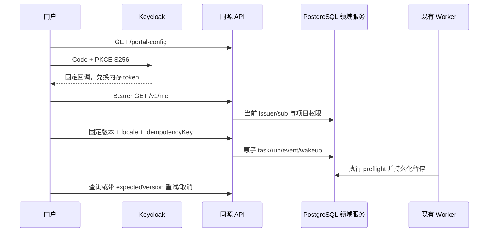

# P1-C Review guide：最小门户、真实登录与双语任务流程

- 批次：004；PR 与远端验证见 [交付索引](README.md)。
- 依赖：P1-B / [PR #3](https://github.com/MaLaNg116/itervane/pull/3)，比较基线 `83656e7f95a00ffc0cc0af4738e64e192bae99ec`。
- 固定代码快照：`6bac8b6fa816248f7c552c079d9d317d023ec99b`。以下源码链接固定在此提交；后续运行说明和验证记录不改变对应代码。
- 日期：2026-11-18；[本批计划](../plans/p1-c-portal-and-login.md)、[运行说明](../control-plane-p1-c.md)、[ADR 0003](../decisions/0003-browser-oidc.md)。

## 1. 交付结果与边界

本批把 P1-B 的真实任务骨架接到最小 React 门户：通过外部身份服务登录，查询当前权限，创建项目、登记仓库、提交固定版本，查看过程、重试 preflight 或取消，最后注销。页面、组件、验证、API 错误、事件和日期支持 en/zh-CN。

任务仍由同一个 API/TaskService/Worker/PostgreSQL 推进；外部 MCP 查询同一任务。不存在浏览器本地模拟成功、另一份任务状态机或第二套授权表。新页面不会拉取/执行仓库，缺少经过验证的 VM 时依旧真实暂停。

v6 的三条闭环、五种逻辑角色、双向 MCP、现代自主 Agent 目标、单维护者/单工作区/全局一个执行中工作流均保留。本批是 M12 门户、P1.1 身份入口和 P1.5 查询/任务操作切片；没有以门户完成替代 P2 Agent Harness，也没有开放批准、部署或运维。

## 2. 阅读顺序

| 顺序 | 固定源码 | 建议关注 |
|---|---|---|
| 1 | [共享契约](https://github.com/MaLaNg116/itervane/blob/6bac8b6fa816248f7c552c079d9d317d023ec99b/packages/contracts/src/control-plane.ts) | 公开登录配置只包含非敏感字段；当前项目角色；实际能力声明 |
| 2 | [API 路由](https://github.com/MaLaNg116/itervane/blob/6bac8b6fa816248f7c552c079d9d317d023ec99b/packages/control-plane/src/api.ts)、[资源服务](https://github.com/MaLaNg116/itervane/blob/6bac8b6fa816248f7c552c079d9d317d023ec99b/packages/control-plane/src/service/resources.ts) | 新增公开配置和受保护读取；复用数据库当前授权；现有写命令保持 |
| 3 | [会话](https://github.com/MaLaNg116/itervane/blob/6bac8b6fa816248f7c552c079d9d317d023ec99b/packages/portal/src/auth.ts) | PKCE、短暂登录 state、内存凭证、会话代次、并发刷新、退出 |
| 4 | [浏览器 API 客户端](https://github.com/MaLaNg116/itervane/blob/6bac8b6fa816248f7c552c079d9d317d023ec99b/packages/portal/src/api.ts)、[查询上下文](https://github.com/MaLaNg116/itervane/blob/6bac8b6fa816248f7c552c079d9d317d023ec99b/packages/portal/src/context.tsx) | 同源请求、严格 schema、超时、缓存分键、401/迟到响应 |
| 5 | [登录与布局](https://github.com/MaLaNg116/itervane/blob/6bac8b6fa816248f7c552c079d9d317d023ec99b/packages/portal/src/app.tsx)、[样式](https://github.com/MaLaNg116/itervane/blob/6bac8b6fa816248f7c552c079d9d317d023ec99b/packages/portal/src/style.css) | 先配置/认证，再领域授权；动态加载页面、nonce、窄屏布局 |
| 6 | [项目列表](https://github.com/MaLaNg116/itervane/blob/6bac8b6fa816248f7c552c079d9d317d023ec99b/packages/portal/src/pages/projects.tsx)、[项目详情](https://github.com/MaLaNg116/itervane/blob/6bac8b6fa816248f7c552c079d9d317d023ec99b/packages/portal/src/pages/project.tsx) | 正式数据、表单、固定 commit、同一请求重试 |
| 7 | [任务详情](https://github.com/MaLaNg116/itervane/blob/6bac8b6fa816248f7c552c079d9d317d023ec99b/packages/portal/src/pages/task.tsx) | 真实状态/事件、principal/worker、绑定版本的确认、冲突提示 |
| 8 | [双语资源](https://github.com/MaLaNg116/itervane/blob/6bac8b6fa816248f7c552c079d9d317d023ec99b/packages/portal/src/messages.ts)、[通用组件](https://github.com/MaLaNg116/itervane/blob/6bac8b6fa816248f7c552c079d9d317d023ec99b/packages/portal/src/components.tsx)、[路由](https://github.com/MaLaNg116/itervane/blob/6bac8b6fa816248f7c552c079d9d317d023ec99b/packages/portal/src/router.ts) | 完整语言键、安全本地返回、日期与错误显示、验证切换 |
| 9 | [静态服务](https://github.com/MaLaNg116/itervane/blob/6bac8b6fa816248f7c552c079d9d317d023ec99b/packages/control-plane/src/portal.ts) | 精确 HTML 路径、构建资源白名单、缓存与 CSP，未放开 API |
| 10 | [真实浏览器测试](https://github.com/MaLaNg116/itervane/blob/6bac8b6fa816248f7c552c079d9d317d023ec99b/packages/portal/test/browser/portal.spec.ts)、[可信测试栈](https://github.com/MaLaNg116/itervane/blob/6bac8b6fa816248f7c552c079d9d317d023ec99b/packages/portal/test/browser/stack.ts) | 真正登录/Worker/DB/MCP，以及故障注入与权限/会话边界 |
| 11 | [PG 夹具](https://github.com/MaLaNg116/itervane/blob/6bac8b6fa816248f7c552c079d9d317d023ec99b/packages/verification/src/postgres-fixture.ts)、[安全报告](https://github.com/MaLaNg116/itervane/blob/6bac8b6fa816248f7c552c079d9d317d023ec99b/packages/portal/test/browser/reporter.ts)、[CI](https://github.com/MaLaNg116/itervane/blob/6bac8b6fa816248f7c552c079d9d317d023ec99b/.github/workflows/verification.yml) | 临时资源归属清理、凭证不出日志、独立 Linux 浏览器验收 |

pnpm-lock.yaml 的新增部分是精确依赖锁定，可先核对 portal/package.json，再核对锁文件。后端仍是 NodeNext 类型检查；门户单独采用 ESNext/Bundler/DOM/React JSX，不为前端改坏 Node 模块约束。

## 3. 登录如何接到已有授权

auth.ts 的 `initialize` 只有一次初始化 Promise，适配 React StrictMode，不重复消费授权响应。回调先移除地址栏 query，再将原始回调交给官方 SDK 核验 state/PKCE 事务。返回位置只接受项目/任务的合法本地 hash，拒绝外部 URL 和路径穿越。

UserManager 使用显式 InMemory userStore；只有短暂 state/verifier 使用 sessionStorage。token() 在到期前使用 refresh token，复用一个 renewal Promise；刷新失败、身份变化或会话代次变化均停止当前请求。若没有 refresh token，会要求登录，不通过隐藏 iframe 绕过边界。

API 客户端只调用受限同源 /v1 路径，携带 Bearer 和展示语言，省略浏览器凭证，不跟随重定向。数据读完后再次核对 epoch；退出时取消/清空私人查询，旧响应不能重新填充工作台。硬刷新丢失凭证属于明确选择，真实 IdP SSO 可以通过重新登录复用。

认证和授权保持分工：签名 token 给出 issuer/sub，数据库给出平台和项目当前权限。新增 project access DTO 仅用于展示按钮，不能授权写入。陌生真实账号仍为 403；没有自动登记 owner，也没有把 token 中的 admin 角色或前端配置当作权限。

## 4. 表单如何避免重复任务

project.tsx 的 TaskForm 在首次提交前，把完整输入及随机 idempotencyKey 同时放入 ref 与 state。ref 使同一轮事件中的重复提交也取得同一份输入；发出请求后锁定表单。

请求响应丢失时，不自动重试 POST，也不替换请求键。用户可以点击“重试同一请求”，发送原来的项目、仓库、commit、目标、数据类别、locale 与 key。既有 TaskService 在真实 PostgreSQL 上返回同一个任务。

浏览器测试实际让第一条 POST 在服务端接受后丢掉响应，再通过界面重试，最后检查两个请求体相等且数据库任务数为一。该故障注入不伪造登录或服务端成功。

## 5. 取消/重试与版本冲突

task.tsx 打开确认框时保存 action 和 expectedVersion，而不是在确认时偷偷替换成最近轮询版本。这样，用户确认的是自己看到的任务版本。

发生真实 409 时关闭旧弹窗、刷新任务与事件，并显示需要重新确认。不会自动重发变更。测试在用户打开取消框后，从另一客户端真实恢复同一个任务，再点击旧确认，验证 409 和任务仍未取消；随后再次明确确认才成功。

重试按钮仅用于 Runner 暂停原因，沿用 P1-B 的剩余工具预算、同一 run、最多三次恢复和执行权检查。这不是批准按钮，当前页面不提供基础设施操作。

## 6. 语言、显示与缓存

messages.ts 由英语键集合约束中文 Record，漏键导致类型失败。AntD 使用对应 locale；服务器状态/错误/事件沿用共享资源，时间由 Intl 按显示语言格式化。改变显示语言只改变 Accept-Language 和展示，不修改已持久化的 task.locale。

查询按身份 epoch、资源和必要的事件语言分键，前台轮询间隔三秒，默认不重试；错误页隐藏过期资源内容。角色变化可通过 access 轮询更新按钮；撤权不能靠隐藏按钮实现，服务端始终重新查权限。本批没有实时权限推送，也不承诺擦除用户已经看过的数据。

恶意目的文本作为 React 文本节点显示，浏览器测试检查没有生成注入的 img 元素。登录返回位置、Git ID 和 HTTPS 仓库地址也分别由共享/本地契约限制。

## 7. 静态服务与复用边界

portal.ts 只加载维护者构建的可信 dist，不接收任务工作区或上传目录。资源在启动时列入 Map，路径不映射任意磁盘文件；未知文件和 API 路径不会返回 index.html。每次 HTML 响应产生 nonce，AntD 使用它生成动态样式；HTML 不缓存，可信资源可缓存。

本批没有新数据库业务迁移、队列、checkpoint 格式或运行连接池。API 6 + Worker 8 的既有最大连接预算保持，浏览器不直接访问数据库。PG 基础设施启动/清理抽出共用 helper，仍使用专用库、低权限业务测试账号和标记归属校验。

复用 React/Vite/AntD、oidc-client-ts、TanStack Query、既有 JWT/资源/任务服务、pg-boss 与 Worker；自研范围集中在页面、公开契约、会话/授权衔接、幂等交互和可审计的验收，不自研身份服务器、OAuth 协议或组件库。

## 8. 本地验证证据

| 验证 | 结果与实际范围 |
|---|---|
| 严格类型 + 单元 | 根工程和门户分别检查；48 单元通过，新增本地安全返回路由检查 |
| 真实 PG17 | 53 通过；保留 P1-B 50 项，新增公开配置、当前项目授权与可信静态边界三项 |
| 真实浏览器 | 9 项：en/zh 完整任务流、非法回调、未知主体、权限变化/撤销、丢响应幂等、409 再确认、刷新/会话撤销、窄屏中文 |
| MCP | 正式同任务由真实 Keycloak token + 官方 MCP SDK 核对；旧本地 MCP 探针三项通过 |
| 评测准备 | 24 份材料含 6 holdout 已校验；可信参考应用构建/五项 HTTP 验证通过，变异源码案例仍等待 VM |

本地环境为 Windows、Node 24.14.0、pnpm 11.9.0、Docker Linux、PG17、Keycloak 26.8.2、本机 Chrome。CI 另在 Ubuntu 24.04 使用 Playwright Chromium；远端结果在交付索引补充，不用 Windows 成功代替 Linux 验收。

本机 Docker 拉取 Quay 曾遇 TLS 握手超时，使用外置维护工具从官方 registry 下载并逐项核验 index/manifest/config/layer digest 后导入本地别名；测试没有关闭 TLS，也没有提交镜像下载工具或私人路径。CI 保持官方固定 digest。pnpm 24 小时发布时间门槛保持，TanStack Query 选已满足门槛的 5.107.0。

测试中的 Keycloak/PG 容器均为可信基础组件，不能证明不可信源码的 VM 隔离已通过。测试专用 MCP token 取得方式只服务于跨入口核对，不构成生产 password grant 或外部助手完整 OAuth 接入。

## 9. 分项提交与剩余事项

提交顺序：计划/ADR → 公开契约/API → React 工程 → OIDC 会话 → 项目/仓库/任务表单 → 任务过程与版本控制 → 门户布局 → 同源静态边界 → PG 夹具复用 → 交互/会话修正 → 真实浏览器测试 → CI → 运行说明 → 本 guide。全部采用中文 Conventional Commits，锁文件随工程依赖引入；没有压成一个阶段大提交。

建议 review 时重点核对 auth.ts/token、api.ts/epoch、project.tsx/attemptRef、task.tsx/expectedVersion、portal.ts/资源 Map，以及测试中的真实 PostgreSQL 结果。审阅时以前述固定快照为准，历史 P1-B guide 不被覆盖。

后续按 [P1 剩余矩阵](../plans/p1-c-portal-and-login.md) 继续：经过验证的 VM/固定快照/真实扫描、规则查询与片段预审、资源映射及其出口证据。应用/环境和成员管理 UI 另批。P2 再实现自主 Agent 审计/修复/独立复验；发布/运维/规则沉淀继续保留 v6 范围。

本批未验公网 TLS/代理/正式 IdP 运维、其他浏览器或多标签单点会话、生产备份恢复、真实模型、VM、扫描、Komodo、Whiskers、批准、发布及规则复用。退出使用标准 RP-initiated logout；IdP 不可达时只确认本地状态清除。当前 AntD 公共 chunk 约 734 kB（gzip 232 kB），保留构建提示，后续按实际加载指标优化。完整 P0/P1/MVP 仍未验收。
