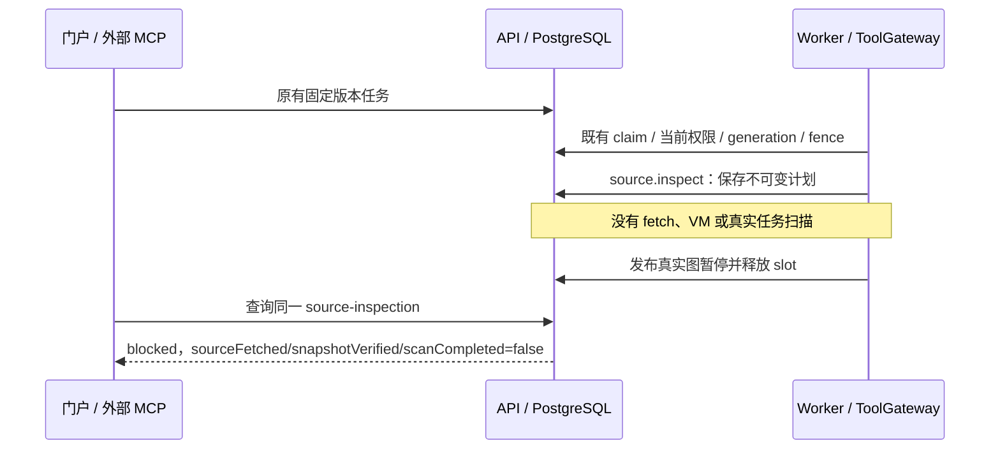

# P1-D1 Review guide：隔离源码检查底座

- 批次：005，[PR #5](https://github.com/MaLaNg116/itervane/pull/5)；远端证据见 [交付索引](README.md)。
- 前置 P1-C / [PR #4](https://github.com/MaLaNg116/itervane/pull/4)，比较基线 `f274c914d54fdcfc9785aa0836ff59f41a200bd4`；不合并前置 PR。
- 固定代码快照：`314664e702bdc6802533f8398dc4e4cbac8e7f99`。以下源码链接固定至此版本，后续文档提交不改变讲解对象。
- 日期：2026-11-18；[D1/D2/D3 计划](../plans/p1-d-isolated-source-inspection.md)、[运行说明](../control-plane-p1-d.md)、[ADR 0004](../decisions/0004-isolated-source-inspection.md)。

## 1. 本批交付什么

Worker 在现有 source.inspect 入口保存正式、不可变的检查计划，再继续真实暂停。API、MCP 和中英文门户查询同一记录。计划清楚区分“请求的 commit”“计划已准备”与尚未发生的源码获取、快照验证和扫描；全部执行能力仍关闭。

纯库已经能验证 Git 内容对象、形成 SHA-256 manifest、生成受保护扫描命令描述、归一化脱敏报告。真实 Gitleaks/Trivy 在维护者生成的合成文件上完成正反对照，证明适配机制；不把这些结果写入业务任务。

v6 三条闭环、五种角色、双向 MCP、外层治理 + P2 自主 Agent、单工作流与 VM 边界保持。当前没有 VM 控制器，没有扫描用户仓库，没有通过变量/上传报告自证隔离，没有以普通容器替代 Runner。

## 2. 阅读顺序

| 顺序 | 固定源码 | 重点 |
|---|---|---|
| 1 | [契约](https://github.com/MaLaNg116/itervane/blob/314664e702bdc6802533f8398dc4e4cbac8e7f99/packages/contracts/src/inspection.ts)、[能力声明](https://github.com/MaLaNg116/itervane/blob/314664e702bdc6802533f8398dc4e4cbac8e7f99/packages/contracts/src/control-plane.ts) | 严格输入、请求源绑定、计划/实际执行分开、false 能力 |
| 2 | [profiles.ts](https://github.com/MaLaNg116/itervane/blob/314664e702bdc6802533f8398dc4e4cbac8e7f99/packages/runner/src/profiles.ts) | 固定版本/配置指纹、网络/资源要求；结构化命令描述，不是宿主执行器 |
| 3 | [snapshot.ts](https://github.com/MaLaNg116/itervane/blob/314664e702bdc6802533f8398dc4e4cbac8e7f99/packages/runner/src/snapshot.ts) | 重新计算 blob/tree/commit；Git 排序、文件模式、路径和限额 |
| 4 | [scans.ts](https://github.com/MaLaNg116/itervane/blob/314664e702bdc6802533f8398dc4e4cbac8e7f99/packages/runner/src/scans.ts) | 退出码、覆盖、库龄、路径绑定、脱敏与失败分类 |
| 5 | [schema](https://github.com/MaLaNg116/itervane/blob/314664e702bdc6802533f8398dc4e4cbac8e7f99/packages/control-plane/src/persistence/schema.ts)、[迁移 0005](https://github.com/MaLaNg116/itervane/blob/314664e702bdc6802533f8398dc4e4cbac8e7f99/packages/control-plane/migrations/0005_inspection_plans.sql) | 每 run 唯一、run/task 复合外键、不可变触发器 |
| 6 | [InspectionService](https://github.com/MaLaNg116/itervane/blob/314664e702bdc6802533f8398dc4e4cbac8e7f99/packages/control-plane/src/service/inspections.ts)、[ToolGateway](https://github.com/MaLaNg116/itervane/blob/314664e702bdc6802533f8398dc4e4cbac8e7f99/packages/control-plane/src/runtime/tools.ts) | 当前执行权内准备，读取检查绑定/指纹，复用权限和事务 |
| 7 | [API](https://github.com/MaLaNg116/itervane/blob/314664e702bdc6802533f8398dc4e4cbac8e7f99/packages/control-plane/src/api.ts)、[MCP](https://github.com/MaLaNg116/itervane/blob/314664e702bdc6802533f8398dc4e4cbac8e7f99/packages/control-plane/src/mcp.ts) | 同一只读记录，不开放执行/上传扫描结果 |
| 8 | [任务卡片](https://github.com/MaLaNg116/itervane/blob/314664e702bdc6802533f8398dc4e4cbac8e7f99/packages/portal/src/pages/task.tsx)、[双语](https://github.com/MaLaNg116/itervane/blob/314664e702bdc6802533f8398dc4e4cbac8e7f99/packages/portal/src/messages.ts) | 准备/阻断与已扫描的区别，保持原任务 locale |
| 9 | [真实 Git 对照](https://github.com/MaLaNg116/itervane/blob/314664e702bdc6802533f8398dc4e4cbac8e7f99/packages/runner/test/helpers/trusted-git.ts)、[快照测试](https://github.com/MaLaNg116/itervane/blob/314664e702bdc6802533f8398dc4e4cbac8e7f99/packages/runner/test/unit/snapshot.test.ts)、[扫描测试](https://github.com/MaLaNg116/itervane/blob/314664e702bdc6802533f8398dc4e4cbac8e7f99/packages/runner/test/unit/scans.test.ts) | 确定性负向验证，不把实现返回值当作唯一真值 |
| 10 | [PG 验证](https://github.com/MaLaNg116/itervane/blob/314664e702bdc6802533f8398dc4e4cbac8e7f99/packages/control-plane/test/integration/inspections.test.ts)、[浏览器](https://github.com/MaLaNg116/itervane/blob/314664e702bdc6802533f8398dc4e4cbac8e7f99/packages/portal/test/browser/portal.spec.ts) | 真 PG、并发/取消/撤权/重领、MCP/门户记录一致 |
| 11 | [工具资产校验](https://github.com/MaLaNg116/itervane/blob/314664e702bdc6802533f8398dc4e4cbac8e7f99/scripts/scanner-tools.ts)、[真实合成样例](https://github.com/MaLaNg116/itervane/blob/314664e702bdc6802533f8398dc4e4cbac8e7f99/scripts/probe-scanners.ts)、[CI](https://github.com/MaLaNg116/itervane/blob/314664e702bdc6802533f8398dc4e4cbac8e7f99/.github/workflows/verification.yml) | 官方固定资产 SHA-256、实际进程、实际漏洞库、证据限定范围 |

新增迁移 snapshot 为 Drizzle 生成的 1441 行机械内容，占 diff 大部分；先读短 SQL/schema，再核对 snapshot。既有迁移 0000—0004 不改写。库只新增 workspace 引用，没有引入新的外部 npm 依赖或放宽供应链门槛。

## 3. 一次业务任务的路径

准备计划是受控数据库元数据写入，不是启动外部作业。它在既有 withLease 短事务中进行，事务前后均检查租约，入口检查当前项目权限。source.inspect 仍返回 runner_unavailable，Worker 图和恢复语义保持。

每个 run 只有一行计划；已存在时验证 document 的 task/run/source 与 SHA-256 并返回原值，不因重试产生新版本。JSONB 的字段顺序不作为哈希依据，严格 Zod parse 还原契约结构后再计算。preparedFence 只是历史事实，不是新的执行授权。

工具预留、计划准备、工具结果和 checkpoint 发布仍有独立事务边界。计划可能已提交而后续结果未发布；此时它仍只表示准备意图，不冒充外部副作用或扫描完成。恢复重用它，旧 fence 不能追加它；未来 VM/产物核对必须在 D2/D3 补齐，不能把此表当作 exactly-once operation ledger。

## 4. 固定源码为什么可信到这个范围

snapshot.ts 不接受压缩包路径或仓库 URL，只接受有界字节：

1. 从完整 commit 长度选择 Git SHA-1/SHA-256 对象格式，核对 `commit <长度>\0<字节>` 的对象 ID。
2. 按普通/可执行文件模式重新计算 blob，再从树叶向上形成 tree。Git 比较目录时按 name/ 排序，不能用语言 locale 排序替代。
3. 树 ID 必须与该 commit 的 tree 一致，缺文件、改文件、换模式都失败。
4. 文件列表按字节稳定排序，记录每个文件 SHA-256/大小/模式，另计算 manifest SHA-256。

测试用真实本地 Git 的 write-tree/commit-tree/cat-file 生成对象进行交叉验证，覆盖两种对象格式、二进制和 executable bit。测试文件全由维护者固定代码生成；没有 checkout 外部项目。

这证明内容绑定，不证明来源/签名，也不证明 VM 安全。限制为便携相对路径、5000 文件、单文件 2 MiB、总 32 MiB、commit 64 KiB；超限、危险路径、重复/大小写碰撞、链接、gitlink、LFS 指针明确拒绝，不能跳过后返回一个“完整”快照。生产获取与后续候选 SHA-256 绑定仍有独立责任。

## 5. 扫描结果为何不会把失败当干净

profiles.ts 固定 Gitleaks 8.30.1 / Trivy 0.76.2、配置哈希、外置 ignore/config 和发现退出码 10；不接受来自项目的可执行配置。Trivy 命令离线、禁止更新库，后续 VM 的扫描阶段要求断网，命令行本身不证明网络隔离已经成立。

scans.ts 先核对进程结果和限额，再解析有限 JSON 结构，重新构造结果：

- completed 与“有无发现”分开；exit 10 需要有发现，exit 0 不能带发现，进程失败/超时不得返回 clean。
- 位置必须属于传入快照，路径越界或不认识的报告结构失败。
- Trivy 仅接受 npm package-lock 清单，要求实际包 inventory；空覆盖记 unsupported。
- 缺少库身份、超过 72 小时或明显来自未来的库记 unavailable；原始 stderr 不被当作业务信息。
- 结果只保留受限规则/CVE ID、路径、行、严重度及指纹，丢弃 Secret/Match、源码、作者、描述与包文本。

这些结果仍是纯函数产物，不存在生产上传入口。未来发布真实证据时必须核对执行权、真实 VM、计划/快照、工具/数据库和产物；不能接受调用方自报这些字段就授予资格。completed 也不代表业务修复、独立复验或可以部署。

## 6. 数据库与 API 边界

0005 在已有 run 上建立复合唯一键，再添加 inspection plan 的 run/task 外键，避免 plan 错绑其他任务。生成 SQL 经检查调整了唯一键与外键的创建顺序；schema snapshot 与最终结构保持一致。

document 的 task/run/version CHECK 使用 IS TRUE，缺字段的 SQL NULL 不能偷偷通过。触发器拒绝 UPDATE/DELETE，运行角色不能 ALTER/DROP 或 TRUNCATE；维护者测试库清理用的是已标记自有库中的整体 TRUNCATE。该触发器需作为手写迁移维护，Drizzle snapshot 不跟踪它。

GET 和 MCP 读取都调用 InspectionService，重新检查当前项目权限；不存在第二套授权。MCP 新工具只有查询，需要 read scope，保留独立 audience。plan 在 queued 时可为 null，读取不会替 Worker 写计划。stage 为 p1-d1，实际源码/隔离/执行/部署/运维能力为 false，严格旧 capability 客户端需同步契约。

## 7. 真实 CLI 探针与证据

probe:scanners 不加载 .env，不接收任何项目路径/URL 参数；从已核验 SHA-256 的官方发布资产解出 CLI，固定调用它们，仅处理自身生成的合成目录。子进程只继承必要 PATH/SystemRoot，不继承模型或平台凭证。

探针实际验证五项：

| 检查 | 事实 |
|---|---|
| Gitleaks 正例 | 合成密钥被检出；受保护 profile 不受项目配置与 inline allow 影响 |
| Gitleaks 修复 | 移除合成密钥后无该类发现 |
| Trivy 缺库 | 空缓存、离线模式实际失败 |
| Trivy 正例 | lodash 4.17.20 的指定 CVE 实际检出 |
| Trivy 修复对照 | 4.17.21 中指定 CVE 消失；不承诺其他 CVE 全部消失 |

漏洞库由官方 GHCR 准备，记录实际文件 SHA-256 与更新时间；扫描前后核对同一库未变。镜像站首次未完成下载后改用官方 GHCR，未关闭 TLS 或使用假库。真实结果中修复对照仍可能存在其他漏洞，这是覆盖事实，不能抹去。

本地 .reports/p1-d/scanners.json 包含 scope=maintainer-generated-fixtures-only、runtimeQualified=false、源码/manifest 和工具/配置/数据库指纹。规范化发现只在忽略报告内，控制台仅给计数；原始进程输出不发布。临时 Git/源/数据库目录只在归属及绝对路径核对后清理。源码指纹为 `fc134d5a29dc894154ccc71c491d3b6e49bdf1bfd7a249d792ff430480ac2034`；生成内容/漏洞库更新会使具体结果不同，不改变代码快照。

## 8. 验收与未覆盖

本地严格类型、60 单元（原 48 + 快照 7 + 扫描 5）、58 真实 PG（原 53 + 计划 5）、9 真实浏览器回归、5 真实 CLI 检查通过。浏览器覆盖新双语卡片与 MCP 同一 plan hash，恢复不重复创建计划。Linux CI 分 deterministic/portal/scanners 三组，远端结果随后写入索引。

| 当前证明 | 当前未证明 |
|---|---|
| Git 对象内容绑定、路径/限额拒绝 | 提交仓库的安全获取与隔离 checkout |
| 可信样例中真实 CLI、数据库身份、脱敏和修复对照 | 任意不可信项目的 VM 内扫描/构建 |
| 真 PG 的并发唯一/回滚/不可变/取消/撤权/过期重领 | VM 限额、宿主/跨任务/内网拒绝、实际停止和销毁 |
| 同一正式准备记录的 API/MCP/双语门户读取 | 真实任务产物发布、未知结果核对、孤儿 VM 清理 |

缺少 KVM 时本批只验 D1，不验 D2/D3 或完整 P1。没有生产 Runner 注册、运行/上传端点或普通容器降级；现有 Worker 继续暂停。P2 现代 Agent 审计/修复/复验、批准发布、P3 运维及 P4 沉淀仍按 v6 保留，未缩减成线性扫描平台。

## 9. 分项提交与后续

顺序：计划/ADR → 隔离/扫描契约 → Git 内容校验 → 脱敏归一化 → 持久化计划/迁移 → API/MCP → 双语门户 → 官方 CLI 正反样例 → 独立 CI → 重领/恢复回归 → 运行说明 → 本 guide。全部使用中文 Conventional Commits。

升级需停 API/Worker、备份、专用迁移账号应用 0005、核对运行角色新表授权、重建门户并重启。计划/截图/探针不授权执行；模型、私人云机、Komodo/Whiskers 和发布流程本批均未触发。

D2 先用真实 KVM + 不可变镜像验证资源、网络、取消、销毁、宿主与跨任务边界。D3 再接真实源获取、库导入、结构化 guest job、受控产物发布、fence/取消/未知结果恢复；另批补规则查询/片段预审与资源映射。没有 KVM 不影响这些独立部分的后续设计，但不能提前验收不可信执行。

## 10. 远端交付证据

- 已验证交付版本 `041a066259f49f17d25a137cb979233fb3f3f790`，源码仍固定为本 guide 顶部的 `314664e`；后续仅补充文档。
- [PR CI](https://github.com/MaLaNg116/itervane/actions/runs/44324198709) 和 [push CI](https://github.com/MaLaNg116/itervane/actions/runs/44324051943) 均 success。Ubuntu 24.04、Node 24.14.0、pnpm 11.9.0 下，deterministic/portal/scanners 三组全部通过，含 60 单元、58 真 PG、9 真浏览器与 5 真 CLI 检查。
- Linux 实际扫描报告仍明确 runtimeQualified=false，与业务任务暂停状态一致；可信样例通过未扩大源码执行资格。生产 VM、真实任务扫描及完整 P1 继续待验。
- 敏感文件与凭证扫描无发现，临时源/身份配置/数据库/CLI 原始报告和工具缓存未提交；PR 保持草稿，依赖未合并 #4。
