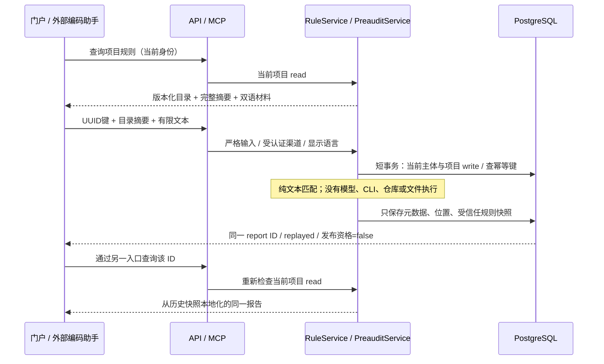

# P1-E Review guide：规则查询与有限文本预审

- 批次：006，[PR #6](https://github.com/MaLaNg116/itervane/pull/6)；远端 CI 见[交付索引](README.md)。
- 前置 P1-D1 / [PR #5](https://github.com/MaLaNg116/itervane/pull/5)，比较基线 `8a9cf3850cbd34204c0f2357a90230836ab586eb`；本批使用 `feat/p1-rules-preaudit`，不合并前置 PR。
- 固定代码快照：`1f93809aef42c70bce52f3dd1fac7af58d929358`。以下源码链接固定至此版本，后续文档提交不改变讲解对象。
- 日期：2026-11-19；[实施计划](../plans/p1-e-rules-and-preaudit.md)、[运行说明](../control-plane-p1-e.md)、[ADR 0005](../decisions/0005-limited-text-preaudit.md)。

## 1. 交付范围与 v6 对照

本批给内外部调用方一个正式规则目录和轻量预审入口：在当前项目内查询有版本、来源和双语说明的材料，提交有限片段或单文件 diff，取得持久化 ID，再通过 API、外部 MCP 或门户查同一结果。

| v6 要求 | 本批落实 | 不提前认领 |
|---|---|---|
| 左移审阅、规则/Skill 复用、双向 MCP | 对外查询目录与持久化预审；共享服务和当前项目授权 | 对内真实运维 MCP 仍在 P3 |
| 结构化发现、证据与限制 | 输入指纹、规则快照、位置、观察类别、覆盖及未覆盖 | 没有完成正式扫描、修复、复验或放行 |
| 外层治理 + 内层自主 Agent | 提供后续可用的固定材料和有界工具结果 | P2-A 的动态工具选择、模型预算、上下文、停止和交接仍待实现 |
| 经验转成可复用能力 | 版本化材料/报告契约，不把文字指导伪装成执行 | P4 的上传、候选、验证、人审发布/回滚及后续复用仍待实现 |
| 隔离执行与真实证据 | 不读取仓库、不启动 CLI/用户代码，所有执行能力继续 false | D2/D3 的真实 VM、获取、扫描、清理和恢复不能由预审替代 |

三条闭环、五种逻辑角色、单维护者/单工作区/全局一个执行中工作流不变。预审不消耗业务执行 slot，因为它是同步有限文本处理，不是 Agent 工作流。完整 P0/P1/MVP 未验收。

## 2. 建议阅读顺序

| 顺序 | 固定源码 | 核心检查点 |
|---|---|---|
| 1 | [共享契约](https://github.com/MaLaNg116/itervane/blob/1f93809aef42c70bce52f3dd1fac7af58d929358/packages/contracts/src/preaudit.ts)、[能力声明](https://github.com/MaLaNg116/itervane/blob/1f93809aef42c70bce52f3dd1fac7af58d929358/packages/contracts/src/control-plane.ts) | 输入严格、限量、advisory，formalScan/releaseEligible 固定 false |
| 2 | [catalog.ts](https://github.com/MaLaNg116/itervane/blob/1f93809aef42c70bce52f3dd1fac7af58d929358/packages/rules/src/catalog.ts) | 3 check + guidance + Skill；版本、来源、双语内容、规范化哈希 |
| 3 | [text.ts](https://github.com/MaLaNg116/itervane/blob/1f93809aef42c70bce52f3dd1fac7af58d929358/packages/rules/src/text.ts)、[engine.ts](https://github.com/MaLaNg116/itervane/blob/1f93809aef42c70bce52f3dd1fac7af58d929358/packages/rules/src/engine.ts) | 有界 diff 只选新增行；固定匹配、来源/位置/覆盖、不保存摘录 |
| 4 | [schema](https://github.com/MaLaNg116/itervane/blob/1f93809aef42c70bce52f3dd1fac7af58d929358/packages/control-plane/src/persistence/schema.ts)、[迁移 0006](https://github.com/MaLaNg116/itervane/blob/1f93809aef42c70bce52f3dd1fac7af58d929358/packages/control-plane/migrations/0006_preaudits.sql) | 项目/主体外键、幂等唯一键、CHECK IS TRUE、历史不可变 |
| 5 | [preaudits.ts](https://github.com/MaLaNg116/itervane/blob/1f93809aef42c70bce52f3dd1fac7af58d929358/packages/control-plane/src/service/preaudits.ts) | 当前权限、短事务、竞争重查、历史快照本地化、输入与报告哈希分开 |
| 6 | [API](https://github.com/MaLaNg116/itervane/blob/1f93809aef42c70bce52f3dd1fac7af58d929358/packages/control-plane/src/api.ts)、[MCP](https://github.com/MaLaNg116/itervane/blob/1f93809aef42c70bce52f3dd1fac7af58d929358/packages/control-plane/src/mcp.ts) | 同一领域服务，独立 audience，创建需项目 write + MCP read/write scope |
| 7 | [预审页](https://github.com/MaLaNg116/itervane/blob/1f93809aef42c70bce52f3dd1fac7af58d929358/packages/portal/src/pages/preaudit.tsx)、[报告页](https://github.com/MaLaNg116/itervane/blob/1f93809aef42c70bce52f3dd1fac7af58d929358/packages/portal/src/pages/preaudit-report.tsx) | 原文仅在表单/ref/request 内存，同键明确重试；规则、覆盖、历史及双语 |
| 8 | [纯规则测试](https://github.com/MaLaNg116/itervane/tree/1f93809aef42c70bce52f3dd1fac7af58d929358/packages/rules/test/unit)、[真实 PG 测试](https://github.com/MaLaNg116/itervane/blob/1f93809aef42c70bce52f3dd1fac7af58d929358/packages/control-plane/test/integration/preaudits.test.ts) | 非执行、原文不落库、并发/冲突/回滚、重启、撤权、不可变 |
| 9 | [外部 MCP 测试](https://github.com/MaLaNg116/itervane/blob/1f93809aef42c70bce52f3dd1fac7af58d929358/packages/control-plane/test/integration/mcp.test.ts)、[浏览器测试](https://github.com/MaLaNg116/itervane/blob/1f93809aef42c70bce52f3dd1fac7af58d929358/packages/portal/test/browser/portal.spec.ts) | 官方 SDK 跨入口同一 ID；真实登录、原文清除、响应丢失重试和中英文 |

Drizzle 的 0006 snapshot 是生成的 1575 行结构描述，占本批 diff 大部分；先读短 SQL 与 schema，再检查 snapshot。没有重写历史迁移，也没有新增外部 npm 依赖。不要因代码行数把生成元数据当作新增执行能力。

## 3. 一次预审的调用路径

没有把文本检查塞进既有 Worker 或伪造业务任务完成。预审提交是受控元数据写入，因此 MCP 需要 write scope；“不执行源码”不代表可以绕过写权限。页面可读不等于可以写，服务端仍拒绝只读成员和已撤权主体。

## 4. 材料、匹配与证据层次

catalog.ts 有 5 条原创材料：eval/HTML 入口形态、字面 gitleaks:allow、服务端授权指导、有限审阅上下文 Skill。材料均带来源、语言适用范围、版本和 en/zh-CN；guidance 与 Skill 的 detector 为 none，coverage 为 guidance_only，不伪装成已检查。

eval/HTML 匹配只返回 suspected，可能位于注释或字符串；allow 标记返回 observed_text，只证明字面存在。受保护正式扫描仍忽略该指令，预审不宣称已经绕过平台。没有模型解释或工作量估算；业务化完整分析在后续 Agent 阶段继续实现。

text.ts 只验证有限单文件 diff 的头、hunk 计数与范围，提取新增行，不触碰任何路径或应用补丁。它不是 Git patch 校验器。engine.ts 不构造调用方正则，不使用 eval/Function/动态加载，不含 CLI/FS/网络调用；用户指令和代码都是待检查的数据。

输入最多 16 KiB UTF-8/1000 行，最多 100 个观察；截断显示 partial，diff 明示未改动行未检查，无新增行记 not_analyzed。无命中只记 no_observations。仓库上下文、正式扫描器、语义和运行时均明确未覆盖；不得把固定匹配数量换成安全分数。

## 5. 哈希、历史、并发和授权

每条 ruleMaterial 先经过严格 Zod parse，再计算其哈希；ruleSnapshot 也先规范化，才参与目录哈希。读回 JSONB 时再次按契约还原字段顺序，避免数据库键排序改变 JSON.stringify 结果。这是为什么不能直接对任意数据库 JSON 文本重新算哈希。

输入哈希绑定规范化请求中的项目、UUID 键、目录摘要、代码语言、格式、数据类别和原文，显示语言/HTTP 或 MCP 渠道不在语义输入中。原文不存储，指纹也不证明来源真实或完成平台固定源码绑定。报告哈希另绑定服务器生成的 ID、主体/项目、首次渠道、结果与规则快照。

创建先检查当前项目 write，再查同主体/项目/键。已存在且输入哈希相同即返回原值；新写入使用数据库唯一约束和 ON CONFLICT DO NOTHING，竞争输家重查原记录。事务失败不会留下半条报告，也不会生成任务、唤醒或 slot。旧目录不能新建，历史相同请求仍可先重放原报告。

GET/list 继续重新检查当前 read，不靠旧 token 的角色声明。历史报告从保存的规则快照翻译，目录更新不会替换旧规则。文档主体/项目绑定、报告哈希与目录哈希在读取时检查；数据库 CHECK IS TRUE 拒绝缺字段，触发器拒绝运行角色更新/删除。它不抵御拥有 DDL 的管理员，也没有暗示 exactly-once 外部副作用。

## 6. 原文生命周期和门户

原文只进入严格输入解析、纯匹配、哈希与当前请求内存；持久化结果没有片段、匹配摘录、文件名或 diff 路径。机器观察只存服务器规则 ID 和位置，展示说明来自受信任材料，React 不把片段作为 HTML。应用既有日志继续只记录脱敏操作元信息，不输出请求体或原始解析异常。

门户首次提交前固定 UUID 和完整尝试内容，禁用编辑；未知网络结果时用户明确重试相同请求，不自动生成新键。mutation 不接受原文 variables，gcTime 为 0，query key 不含原文；临时内容放在 Form/ref 中。成功先清空再导航，离开、登出、撤权卸载私人状态。重置会清空旧尝试，历史查询仍可找回服务端已接收记录。

SHA-256 不是加密或匿名化，不适合提交私人数据。数据类别只是调用方声明，第三方编码助手或自托管代理仍有自己的日志策略。本批明确只接收公开/模拟数据，不把“应用不落库”扩大解释为整条外部链路无留存。

界面提供真实规则目录、输入、报告与最近 100 条记录，长历史没有分页承诺。显示语言可切换，报告 ID、hash 与首次渠道不变。只读成员可查询，撤权轮询后隐藏私人内容；报告没有批准、运行或发布入口。

## 7. 本地证据与 Linux CI

| 验证 | 本地结果 | 新增覆盖 |
|---|---|---|
| pnpm check | strict types + 73 单元通过 | 原 60 + 13 目录/文本测试；恶意指令不执行、控制字符/超限、diff、误判和覆盖 |
| pnpm test:integration | 66 真 PG 通过 | 原 58 + 6 报告事务/权限 + 2 官方 MCP/HTTP 跨入口测试 |
| pnpm build:portal | 通过 | 双语规则/报告 lazy route；保留既有公共 chunk 大小提示，不影响构建 |
| pnpm test:portal | 15 真浏览器通过 | 原 9 + en/zh 2、丢响应重试、只读撤权、diff、中文 UTF-8/窄屏 4 项 |

浏览器使用真实 Keycloak、PostgreSQL、API、Worker、Chrome 和官方外部 MCP Client，不 mock 登录/预审成功。检查唯一私有 canary 不出现在 DB/report/browser storage，片段中的 HTML 不产生 DOM 执行；返回项目后输入为空。断网用例先真实接收 201 再丢响应，重试后仍只有一条数据库记录。

脱敏浏览器报告沿用 `.reports/p1-c/browser.json`，本次 15/15 通过、源码指纹 `99cb20b72d18ca3f9a9792cd954cafa613cd795237cf3621728002efe24bbcee`；新截图在忽略目录 `.reports/p1-e/`。报告、身份配置、临时数据库、截图、原始输入和 CLI 缓存均不提交。CI 沿用 deterministic/portal/scanners 三组，远端链接与最终交付版本在索引补齐。

原有 5 项真实 Gitleaks/Trivy 可信样例验证在独立 scanners CI 保留；它们不是这批预审，也不替 Runner 授权。本批未调用真实模型、私人云机、Komodo 或 Whiskers。

## 8. 分项提交与接续

顺序：计划/ADR → 版本化双语规则与 Skill → 有界文本/diff → 持久化/授权/幂等 → HTTP/MCP → 双语门户 → 真实浏览器验证 → 运行说明 → 固定快照 guide/索引。各需求点使用中文 Conventional Commits。

升级需停旧 API/Worker、备份、独立账号追加 0006、核对运行角色授权、重建门户并重启；没有新增常驻服务或开关放行。P1-E 只验收本切片，D2/D3、完整 P1 与所有三条 MVP 闭环仍有剩余工作。

后续可以独立规划 P1 资源映射或 P2-A Harness 契约/可信工具验证，实际自主审计与源码修复仍等待合格 Runner。规则/Skill 上传和沉淀必须按 P4 补验证、人审和版本生命周期，不能将内置目录当作已完成 P4。

## 9. 远端交付证据

- [草稿 PR #6](https://github.com/MaLaNg116/itervane/pull/6) 基于未合并的 #5，比较基线与固定代码版本保持本 guide 顶部记录。
- 已验证文档交付版本 `54e095fd3add9a028105bf0141d95dbf0384efcc` 的 [PR CI](https://github.com/MaLaNg116/itervane/actions/runs/44501368994) 和 [push CI](https://github.com/MaLaNg116/itervane/actions/runs/44501335089) 均 success；Ubuntu 24.04、Node 24.14.0、pnpm 11.9.0 下 deterministic/portal/scanners 全部通过，包含 73 单元、66 真 PG、15 真浏览器和原 5 项可信样例 CLI 检查。
- Linux 浏览器/扫描器的源码指纹均为 `99cb20b72d18ca3f9a9792cd954cafa613cd795237cf3621728002efe24bbcee`，与本地浏览器一致。真实扫描报告仍为 runtimeQualified=false，完整 Runner 资格没有变化。
- 新提交 blob 的本机敏感值/私人标识/私钥头扫描无发现，忽略配置和报告未提交。随后仅补充 PR/证据记录，不改变固定代码；前置 PR 未自动合并。
