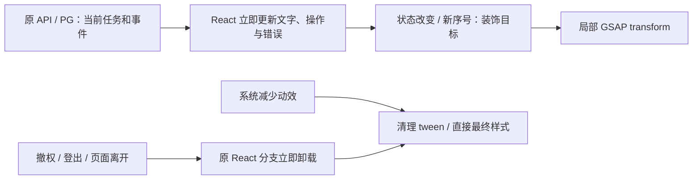

# P1-UX Review guide：门户设计与 GSAP 动效

- 批次：007；叠加草稿 PR 与远端证据见[交付索引](README.md)。
- 前置：[P1-E / PR #6](https://github.com/MaLaNg116/itervane/pull/6)，比较基线 `2390bb3629f5567e90093fb3a737794b3bfdbb10`；分支 `feat/portal-design-motion`，不合并前置 PR。
- 固定代码快照：`cd300546c0cb7f902b745989e2854e0fb598dfd8`。下列源码链接固定到此版本，之后文档提交不改变讲解对象。
- 日期：2026-11-20；[实施计划](../plans/p1-ux-portal-design-motion.md)、[运行说明](../portal-design-motion.md)、[第三方 UI 记录](../third-party-ui.md)。

## 1. 本批交付与 v6 对照

这是现有门户的独立体验切片：统一品牌、语义 token、项目索引、任务状态面板、证据元数据和中英文信息层级；加入与真实变化对应的 GSAP 微反馈，以及初始/动态减少动效支持。

| v6/既有边界 | 本批结果 |
|---|---|
| 平台记录与真实证据决定状态 | Task DTO/事件先立即呈现，圆点和新增序号随后作装饰反馈；没有假进度或动画驱动状态 |
| 当前授权、审批与版本确认 | API/MCP/领域服务保持；只读、撤权、登出、409 和明确确认继续回归 |
| 原文仅在预审请求/组件内存 | 不进入动画 props、data 属性、query key、日志或持久化；原有跨入口与隐私用例保留 |
| Runner、发布、运维资格 | capability 仍为 p1-e，相关执行能力 false，没有迁移/新端点/开关放行 |
| Agent 工程与三条闭环 | 不替代 P2-A 自主 Harness、P3 运维或 P4 规则/Skill 上传与沉淀；完整 P0/P1/MVP 未验收 |

## 2. 设计参考如何落地

实际读取了固定版本 [UI UX Pro Max](https://github.com/nextlevelbuilder/ui-ux-pro-max-skill/blob/2de1134dc4d1cfe112934611ae5803ae17a1bd7e/.claude/skills/ui-ux-pro-max/SKILL.md) 和 [frontend-design](https://github.com/anthropics/skills/blob/e4bb5d960d87126ff3b3a8af1a104b7db67560ba/skills/frontend-design/SKILL.md)。产品方向和检索采纳记录在计划中；Skill 仅指导开发，不进入产品运行，也不被当作已完成 P4。

Itervane 需要快速识别当前状态和证据，因而采用深色导航、明亮内容、较紧凑的任务信息，保留对真实 hash/ID 的精确展示。没有照搬检索结果中的营销 landing、玻璃背景或虚构指标。最显著的视觉元素是任务状态与活动轨迹；项目按行组织，正文/元数据/操作有明确层级。

系统字体覆盖中文与英文，不增加远程字体/图像依赖。原创 SVG 品牌标记与导航图标具有装饰语义。正常文本 ink/白色对比度约 14.64:1，辅助 muted/白色约 6.05:1，brand/白色约 6.06:1，导航辅助文字/深色约 8.82:1；这是对应实色的数值检查，不是整个产品的可访问性认证。

## 3. 建议阅读顺序

| 顺序 | 固定源码 | 检查点 |
|---|---|---|
| 1 | [design.ts](https://github.com/MaLaNg116/itervane/blob/cd300546c0cb7f902b745989e2854e0fb598dfd8/packages/portal/src/design.ts)、[style.css](https://github.com/MaLaNg116/itervane/blob/cd300546c0cb7f902b745989e2854e0fb598dfd8/packages/portal/src/style.css) | 单一调色板、AntD 主题、全局公共变量、响应式/焦点/减少动效，长页面导航可达 |
| 2 | [brand.tsx](https://github.com/MaLaNg116/itervane/blob/cd300546c0cb7f902b745989e2854e0fb598dfd8/packages/portal/src/brand.tsx)、[app.tsx](https://github.com/MaLaNg116/itervane/blob/cd300546c0cb7f902b745989e2854e0fb598dfd8/packages/portal/src/app.tsx) | 原创标记、固定 nonce 样式、同一 SessionGate/权限/路由，未引入退出保留层 |
| 3 | [motion.tsx](https://github.com/MaLaNg116/itervane/blob/cd300546c0cb7f902b745989e2854e0fb598dfd8/packages/portal/src/motion.tsx) | MQL 订阅清理、useGSAP/contextSafe、固定时序、限定目标、无 API 或私有原文 |
| 4 | [components.tsx](https://github.com/MaLaNg116/itervane/blob/cd300546c0cb7f902b745989e2854e0fb598dfd8/packages/portal/src/components.tsx)、[projects.tsx](https://github.com/MaLaNg116/itervane/blob/cd300546c0cb7f902b745989e2854e0fb598dfd8/packages/portal/src/pages/projects.tsx) | 标题装饰线和项目行；未因动画隐藏正文或改变访问行为 |
| 5 | [task.tsx](https://github.com/MaLaNg116/itervane/blob/cd300546c0cb7f902b745989e2854e0fb598dfd8/packages/portal/src/pages/task.tsx) | 当前状态、类别与任务语言均来自原 DTO；新序号反馈，现有确认与异常路径保留 |
| 6 | [preaudit-report.tsx](https://github.com/MaLaNg116/itervane/blob/cd300546c0cb7f902b745989e2854e0fb598dfd8/packages/portal/src/pages/preaudit-report.tsx) | 原生 Disclosure、报告指纹与覆盖，不动画化输入、不赋予发布资格 |
| 7 | [browser-policy.ts](https://github.com/MaLaNg116/itervane/blob/cd300546c0cb7f902b745989e2854e0fb598dfd8/packages/portal/src/browser-policy.ts)、[main.tsx](https://github.com/MaLaNg116/itervane/blob/cd300546c0cb7f902b745989e2854e0fb598dfd8/packages/portal/src/main.tsx)、[bootstrap.tsx](https://github.com/MaLaNg116/itervane/blob/cd300546c0cb7f902b745989e2854e0fb598dfd8/packages/portal/src/bootstrap.tsx) | Zod 构造 object schema 前启用 jitless；明确异步模块边界，服务器配置不受影响 |
| 8 | [messages.ts](https://github.com/MaLaNg116/itervane/blob/cd300546c0cb7f902b745989e2854e0fb598dfd8/packages/portal/src/messages.ts)、[真实浏览器用例](https://github.com/MaLaNg116/itervane/blob/cd300546c0cb7f902b745989e2854e0fb598dfd8/packages/portal/test/browser/portal.spec.ts) | typed en/zh-CN、真实登录、正常/减少动效、权限/轮询与键盘测试 |
| 9 | [依赖](https://github.com/MaLaNg116/itervane/blob/cd300546c0cb7f902b745989e2854e0fb598dfd8/packages/portal/package.json)、[构建配置](https://github.com/MaLaNg116/itervane/blob/cd300546c0cb7f902b745989e2854e0fb598dfd8/packages/portal/vite.config.ts) | 只增加精确 GSAP/@gsap/react，保留许可提示和构建清单；不开放新静态路径 |

## 4. 动效时序与数据权威

HeadingAccent 只改变装饰短线；StateMarker 比较上一真实 state，只在值改变时反馈；useNewEventMotion 比较有界 sequence 集合，初次列表不动、每批最多 3 项。时间线文字全部直接渲染，不自动滚动或抢焦点。显示语言不参与状态/事件标识，普通轮询不会重播。

Disclosure 使用原生 details/summary，立即开关。contextSafe 记录事件回调创建的 tween，快速切换时先终止旧目标，再按当前偏好处理。所有目标都有组件 ref/scope；没有全局私有 DOM 查询、cloneNode、退出层或动画回调写 API。context 在卸载和依赖变化时还原目标样式。

## 5. 两个需要理解的兼容决定

**稳定主题边界。** 在 AntD 6.7.1 中，动态 true→false 的 motion token 会第一次插入 Motion Provider，重挂载其子树。会话和表单不能因此丢失，所以 token 固定 false；GSAP/CSS 单独响应媒体偏好。实际浏览器已验证减少偏好切换后登录、展开状态与焦点保留。

**先配置再装载。** Zod 4.6.7 在 object schema 构造时缓存 JIT 能力；在 render 前配置但晚于 schema 构造仍会触发被 CSP 阻断的探测。browser-policy 使用公开 jitless 配置，main 在其后动态装载 bootstrap，打包不会把应用 schema 提前执行；解释校验仍使用同一严格契约。

颜色变量从源码固定 palette 生成，style 使用当前 HTML nonce，供 body 下的 Modal/Select portal 继承。没有用户字符串参与 CSS，也不把 nonce 当作业务权限。script/style/connect 等 CSP 白名单、OIDC PKCE/内存 token、MCP audience 与领域授权未更改。

## 6. 真实验证

| 检查 | 结果与范围 |
|---|---|
| strict types / 单元 | 73 通过；不为颜色值或 CSS 属性编写镜像单元测试 |
| 真实 PostgreSQL | 原有 66 通过，涵盖事务、授权、幂等、fence/恢复、外部 MCP 等；没有新 schema 或后端逻辑 |
| 真实浏览器 | 20 项整套回归通过；已有 15 + 新增 5 项，截图整理后另外复验这 5 项 |
| 生产构建 | 同源带哈希资产及第三方许可清单生成成功；共享组件 chunk 仍有体积提示 |
| Linux CI | 沿用 deterministic/portal/scanners 三组，包含原 5 项可信扫描器回归；实际远端链接随后写入索引 |

新增 5 项使用真实 Keycloak、PG、API/Worker 与 Chrome：

1. 正常动效下，真实取消产生状态/事件反馈，两个真实轮询及语言变化不重播；Runner/部署/运维 capability 仍 false。
2. 键盘开关报告元数据、动态切换减少偏好，内容/登录/焦点保留；返回项目后原报告视图移除、输入为空。
3. 正常动效下撤权，错误呈现时旧规则节点已移除，没有退出保留层。
4. 英文正常模式下，375/768/1365px 的表单/弹窗/跳转焦点无页面横向溢出。
5. 中文减少模式下同一路径可用，新增 GSAP transform 写入为零。

测试用 MutationObserver 记录固定目标的 transform 次数和脱敏 CSP 分类，未将 GSAP 或 API 成功 mock 掉。应用截图只含维护者生成的测试数据，不保存登录页、token 或浏览器 trace；报告仍沿用 .reports/p1-c/browser.json，新截图在 .reports/p1-ux/，均忽略提交。

## 7. 已知边界与部署

原 rc-component 的无 nonce 辅助测量/滚动锁及 CSS 特性样式仍会被原 CSP 阻断，未为此加入 unsafe-inline；测试只分类其已知生成样式，其他脚本/样式违规仍失败。因此不把 CSP 总事件数称作零，也不宣称背景滚动锁已完整验收。

没有全面无障碍认证、Lighthouse/所有设备帧率基准或完整暗色主题；深色导航配明亮内容不等于实现暗色模式开关。当前最大共享组件 chunk 约 805 kB（gzip 约 261 kB），保留后续性能优化，不通过修改警告阈值隐藏提示。

升级只需锁定依赖、重建门户并重启 API 使其更新内存资产映射，无数据库迁移或新凭证。构建包保留 third-party-licenses.md；GSAP 保留独立许可，自有代码仍 Apache-2.0。没有调用真实模型、私人云机、Komodo 或 Whiskers；三条闭环与 Runner 闸门保持。

本批先交付计划，再分别提交视觉、GSAP 生命周期、任务/报告接入、兼容修复、构建许可、真实浏览器及文档导读，均使用中文 Conventional Commits。后续仍按 v6 补齐 P1 余项和 P2—P5，不把体验批次当作完整 P1/MVP。
